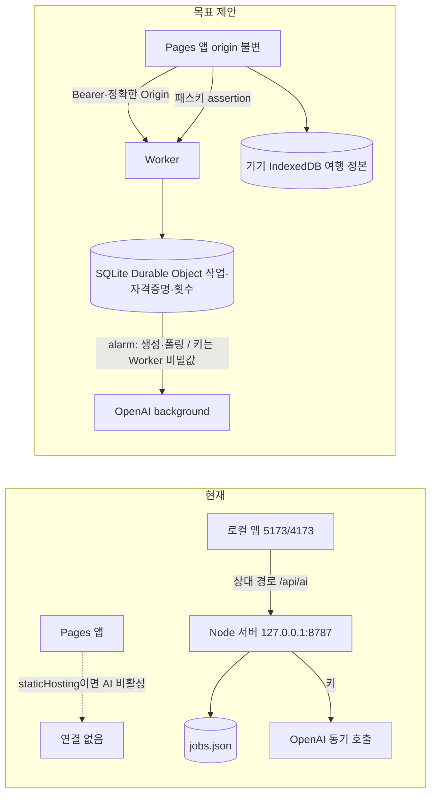

# T-D0 결과 · D단계 기준 고정·공백 재현·Worker 이식 조사

2026-11-06 · 기준 main `cf57451`(제품 코드는 `e0c4013`과 동일) · 브랜치 `codex/d00-baseline` · **Claude 자체 검사 완료 / Codex 검토 대기 / 사용자 미확인**

## 요약

1. **제품 변경 없음.** `pnpm run check` exit 0(342 통과·1 건너뜀), AI 단위 23개·E2E 4개 통과. 외부 호출·계정·키 사용 0.
2. **v2 모의 흐름은 C-15 이후에도 동작한다.** 단 E2E는 서버를 모의하므로 실제 전송 body를 검사하지 않는다.
3. **전송 표면이 설계 §5보다 넓다(차단).** 조사 호출에 자유 요청 원문·무관한 장소 이름이 들어간다. 작성 호출에 `executionMarkers`·`bookingIds`·`menuText`·`backupText`·`needsReview`가 들어가고, 기록을 켜면 정정 전 기록·다른 날짜 메모까지 간다.
4. **BM-2 없음(차단).** 도착/출발 제약이 없고, 예약 활동의 시각 변경·제거, 03시 추가, 종료<시작을 로컬 검증이 통과시킨다.
5. **유료 호출 뒤 결과 유실 경로(차단).** 저장 실패 시 결과를 버리고 `failed`가 되며 사용량도 읽지 않는다.
6. **간헐 실패 원인 추정: Windows `rename` EPERM.** 앱 없는 단순 루프에서 저장소 안 45/3000, %TEMP% 0/3000. 7/20회 실패로 재현했고 잡고 있는 프로세스는 미확인이다.
7. **Worker 권고: SQLite Durable Object + alarm + OpenAI background 폴링.** 로컬 workerd 스파이크에서 무인증 401, 중복 5건에 상위 호출 1회, 호출 중 재시작 후 재호출 0회·`unknown` 표시를 확인했다. 현재 v2 검증 코드는 수정 없이 workerd에서 돈다.
8. **인증 권고: 패스키 + 짧은 수명 Bearer 토큰(쿠키 없음).** Cloudflare Access는 교차 사이트 쿠키 의존이라 비권고. iPhone 실동작은 미검증이다.
9. **예산 한도:** 기본 알림만, "Enforce a hard limit"를 켜면 429로 차단. 즉시 차단은 아니고 월 단위다. 금액 원장은 빼고 횟수 한도·요청당 상한을 유지한다.
10. **모델:** 권고 후보 `gpt-6-luna`·`gpt-6.1-terra`. 확정은 U-D2.

**사용자 결정 필요:** §6 표 4건.

### 증거 색인

| 증거                          | 위치                                                                                                                      | 성격                     |
| ----------------------------- | ------------------------------------------------------------------------------------------------------------------------- | ------------------------ |
| 전송 캡처·의미 검증·HTTP 경계 | [send-surface.probe.ts](d00/send-surface.probe.ts) → [send-surface.json](d00/send-surface.json)                           | 모의(fetch 대체)·가상    |
| 간헐 실패                     | [flake.probe.ts](d00/flake.probe.ts) → [flake-stress.json](d00/flake-stress.json), [rename-loop.mjs](d00/rename-loop.mjs) | 로컬 실측                |
| 검증 CPU                      | [cpu.probe.ts](d00/cpu.probe.ts) → [cpu.json](d00/cpu.json)                                                               | Node 근사, workerd 아님  |
| Worker 스파이크               | [worker-spike/](d00/worker-spike/) → [results.json](d00/worker-spike/results.json)                                        | 로컬 workerd·가짜 OpenAI |

재실행: `pnpm exec vitest run --config docs/d00/vitest.probe.config.mts`. 스파이크는 `local-data/d00-worker-spike/`에 wrangler 4.158.0을 설치해 돌렸고 저장소 의존성은 그대로다.

## 구조도

## A. 현 AI 경로 대조·공백

**흐름 확인.** 기존 시험 기준 요청→조사/초안→Stage→Decide가 동작한다. 깨진 곳은 없다. 한계: `tests/e2e/ai-v2.spec.ts:33`은 `page.route`로 서버를 대체하고, 금지 검사는 `SYNTHETIC-PRIVATE` 두 값뿐이다. 그래서 아래 전송 공백이 녹색 시험에 가려져 있다.

### A-1. 전송 표 대조 (모의 provider body 실측)

필드마다 표식을 심어 `OpenAiV2Provider`의 실제 body에서 찾았다. 1·2일 선택, 3일째는 범위 밖.

| 데이터                                                                                       | 조사 호출(웹 검색) | 작성 호출                             | 설계 §5 판정                |
| -------------------------------------------------------------------------------------------- | ------------------ | ------------------------------------- | --------------------------- |
| 요청 자유문장                                                                                | **원문 그대로**    | 포함                                  | 조사 위반: 정제한 질문만    |
| 선택 날짜 제목·도시                                                                          | 포함               | 포함                                  | 허용(자유문장 주의)         |
| 무관한 장소 이름                                                                             | **포함**           | 포함                                  | 위반                        |
| 무관한 장소 요약                                                                             | 제외               | **포함**                              | 위반                        |
| `executionMarkers`(type·detail·label)                                                        | 제외               | **포함**                              | 위반 소지                   |
| `bookingIds`·`menuText`·`officialUrl`·`mapTargetId`·`sourceFlags`                            | 제외               | **포함**                              | 허용 목록 밖                |
| 날짜 `backupText`·`needsReview`·`fatigueText`·`food`·`transport`·`highlights`·`sourceStatus` | 제외               | **포함**                              | 허용 목록 밖                |
| 날짜 사진 캡션(저작자·라이선스)                                                              | 제외               | **포함**                              | 불필요                      |
| 여행 이름·계획 사유                                                                          | 제외               | **포함**                              | 허용 목록 밖                |
| 기록(켰을 때)                                                                                | 제외               | **전체**(정정 전·다른 날짜 메모 포함) | 위반: 최신 유효·선택 항목만 |
| `reservationText`·`executionNote`                                                            | 제외               | 제외                                  | 충족                        |
| 숙박 `baseText`, 범위 밖 날짜·활동                                                           | 제외               | 제외                                  | 충족                        |
| 가이드·fact·자산 경로·`sourceRefs`·기록 `targetSummary`                                      | 제외               | 제외                                  | 충족                        |

기록을 끄면 기록 표식은 전혀 들어가지 않는다. 화면 문구 "예약의 비공개 필드는 보내지 않습니다"(`src/content/AiPlanner.tsx:204`)는 `executionMarkers`·`bookingIds` 전송과 어긋날 수 있다. 실제 여행에서 이 필드에 무엇이 들었는지는 측정하지 않았다(가상 데이터만 사용).

### A-2. 공백 표

| #   | 공백                                                                                                 | 근거                                             | 심각도                                    |
| --- | ---------------------------------------------------------------------------------------------------- | ------------------------------------------------ | ----------------------------------------- |
| G1  | 조사 호출에 요청 원문·전체 장소 이름 전달                                                            | `server/ai-v2.ts:61-66`, 캡처                    | **차단**(데이터)                          |
| G2  | 활동·날짜 전체 전개(제외 목록 방식)                                                                  | `src/ai-v2-context.ts:20`                        | **차단**(데이터)                          |
| G3  | 참조와 무관한 전체 장소 전송                                                                         | `src/ai-v2-context.ts:24-34`                     | **차단**(데이터)                          |
| G4  | 기록이 전체/없음 둘뿐. 정정 전·다른 날짜 포함                                                        | `src/ai-v2-context.ts:57-71`                     | **차단**(데이터)                          |
| G5  | `consent: true`를 미리보기 생성 때 박음. 지문·모델·한도와 묶이지 않음                                | `src/ai-v2-context.ts:39`                        | **차단**(권한·비용)                       |
| G6  | BM-2 없음: 스키마·지시문·검증 모두. 예약 활동 시각 변경·제거, 03시 추가 통과                         | 캡처 `semantic`                                  | **차단**(충돌)                            |
| G7  | 종료<시작 시각 통과                                                                                  | 캡처 `semantic`                                  | **차단**(데이터)                          |
| G8  | BM-5 없음: leg 걸린 활동 제거 적용 시 leg가 경고 없이 사라짐                                         | 캡처 `leg`(적용 후 leg 0)                        | **차단**(충돌)                            |
| G9  | 저장 실패 시 유료 호출 결과를 버리고 `failed`. 메모리·파일 상태 불일치, 로컬 경로가 오류 문구로 노출 | `server/ai-v2-jobs.ts:161,183-193`, 스트레스     | **차단**(비용·데이터)                     |
| G10 | `usage`를 읽지 않음. 사용량·잔여 표시 불가                                                           | `server/ai-v2.ts`에 `usage` 없음                 | **차단**(비용)                            |
| G11 | 입력 토큰 상한 없음(`max_output_tokens`만, 입력은 1 MiB)                                             | `server/index.ts:71`, `server/ai-v2.ts:71,89`    | **차단**(비용)                            |
| G12 | 무인증 list/get/cancel. 결과까지 반환. 현재는 127.0.0.1 바인딩만이 방어                              | 캡처 `http`                                      | **차단**(권한, 공개 시)                   |
| G13 | v1 경로가 v2 비활성에도 열려 있고 같은 키 사용. 전체 장소·기록 메모 전송                             | `server/index.ts:93-121`, `server/ai.ts:21-40`   | **차단**(권한·데이터). Worker에 이식 금지 |
| G14 | 보관 200건 뒤 삭제 경로가 없어 영구 차단. 결과 무기한 보관, ACK 없음                                 | `server/ai-v2-jobs.ts:110-115`                   | 중(보관)                                  |
| G15 | BM-1 없음: 미확인 고정·확인 시각 없음. BM-3·BM-6 없음(근거 종류·항목별 사유)                         | `server/ai-v2.ts:124-131`                        | 높음                                      |
| G16 | 폴링이 오류 한 번에 멈춤(재시도 없음)                                                                | `src/content/AiPlanner.tsx:116-120`              | 중(모바일)                                |
| G17 | 호출 120초×3 > 작업 300초                                                                            | `server/ai-v2.ts:40`, `server/ai-v2-jobs.ts:156` | 낮음                                      |
| G18 | 429를 한 문구로 뭉침. `project_spend_limit_exceeded` 구분 불가                                       | `server/ai-v2.ts:45`                             | 중(비용 안내)                             |
| G19 | API 경로가 상대 경로·`staticHosting` 비활성 고정                                                     | `src/content/AiPlanner.tsx:22,64`                | T-D2 범위                                 |

### A-3. C단계 데이터가 AI에 들어가는 방식

| 데이터      | 현재                                                                        | 영향                                                                          |
| ----------- | --------------------------------------------------------------------------- | ----------------------------------------------------------------------------- |
| 현장 기록   | 체크 시 전체. 요약 문자열로 평탄화, 날짜·대상 연결 없음                     | G4. 날짜 선택 전송이 불가능한 형태                                            |
| 회고        | 보내지 않음. 기록·계획에서 계산하는 읽기 모델(`src/content/retro-rules.ts`) | 문제 없음                                                                     |
| stay        | 항상 `[]`                                                                   | 비공개 보호에는 맞지만 그날 거점을 AI가 모름. `overnightRegionId`는 ID만 전달 |
| leg         | 양 끝이 선택 범위면 전송(`lineText` 포함)                                   | 시간표 충돌 판단 재료는 있으나 검증 없음(G8)                                  |
| 날짜 사진   | 바이트는 없음. ID·캡션 전송                                                 | 토큰 낭비                                                                     |
| 가이드·fact | 보내지 않음                                                                 | 안전. 다만 저장된 운영시간 등을 AI가 못 봄. 추가 여부는 U-D3                  |

### A-4. BM-2 현황

들어가지 않는다. 항목별 `time`과 `bookingIds`는 가지만 "고정"이라는 뜻이 없고, 스키마에 도착/출발 필드도 없다. `reservationImpact`는 모델 자유문장이다.

### A-5. 간헐 실패

| 실행                                            | 결과                                                                                                    |
| ----------------------------------------------- | ------------------------------------------------------------------------------------------------------- |
| `tests/ai-v2.test.ts` 단독 20회(다른 작업 없음) | **7회 실패**. `Test timed out in 5000ms` 5건, `expected 'queued' to be 'researching'`, 호출 횟수 불일치 |
| 전체 `vitest run` 6회                           | 0회 실패. 단독보다 왜 안정적인지는 미확인                                                               |
| 작업 저장소 300회 스트레스                      | 정상 294 / `EPERM rename` 5 / **메모리 failed·파일 validating 1**                                       |
| 앱 없는 write+rename 3000회                     | 저장소 `.cache` **45 EPERM**, `%TEMP%` **0**                                                            |

**원인 추정(확정 아님):** `persist()`의 rename이 저장소 폴더에서 간헐 EPERM으로 실패한다.

- 최종 저장 실패 → 메모리 `failed`, 파일 이전 상태 → C-15의 `expected validating to be failed`와 같은 모양.
- 중간 저장 실패 → `failed`로 빠짐 → `awaiting-decision`을 기다리다 `waitFor`와 시험 제한(둘 다 5초)에 걸려 시간 초과.
- 앱 코드 없이 폴더 위치만으로 갈리므로 앱 논리 경합은 아니다. 폴더를 잡는 프로세스(감시기·색인·백신)는 특정하지 못했고, 잠금 재현 시도는 실패했다.
- CI(Linux) 실패 기록은 조회하지 않았다.
- 실행 경로 `local-data/ai-v2-jobs`도 같은 저장소 폴더라 **시험만의 문제가 아니다**(G9).

## B. Cloudflare Worker 이식

### B-1. Node 의존 대체

| 현재                                                          | 위치                         | Worker 대체                                                | 확인                                              |
| ------------------------------------------------------------- | ---------------------------- | ---------------------------------------------------------- | ------------------------------------------------- |
| `node:http` 서버                                              | `server/index.ts:1`          | `fetch` 핸들러                                             | 스파이크                                          |
| `jobs.json`(`node:fs`)                                        | `server/ai-v2-jobs.ts:1`     | SQLite DO. `node:fs`는 요청별 가상 파일이라 쓸 수 없음     | 문서·스파이크                                     |
| 상주 `Map`·`AbortController`                                  | `server/ai-v2-jobs.ts:24-25` | DO 행 + OpenAI cancel                                      | 스파이크(취소 제외)                               |
| `void this.execute()` 백그라운드                              | `server/ai-v2-jobs.ts:138`   | alarm 단계 실행                                            | 스파이크                                          |
| `setTimeout` 300초                                            | `server/ai-v2-jobs.ts:156`   | 생성 시각 비교                                             | 설계                                              |
| `process.env`                                                 | `server/index.ts:134`        | Worker 비밀값, 로컬 `.dev.vars`                            | 스파이크                                          |
| 재시작 시 interrupted                                         | `server/ai-v2-jobs.ts:41-44` | `calling` 상태면 `unknown`, response id가 있으면 폴링 재개 | 스파이크                                          |
| `node:crypto`(v1만)                                           | `server/jobs.ts:3`           | v1 비이식. v2는 `crypto.subtle`                            | 스파이크                                          |
| 127.0.0.1 Host 검사                                           | `server/index.ts:20-26`      | 정확한 Origin + 인증                                       | 스파이크                                          |
| zod·`materializeV2Proposal`·`canonicalJson`·`AbortSignal.any` | —                            | **수정 없이 동작**                                         | [port.worker.js](d00/worker-spike/port.worker.js) |
| `collectedSources` import가 `server/ai.ts`(v1)를 끌어옴       | `server/ai-v2.ts:10`         | 번들은 되지만 v1 격리를 위해 분리 권장                     | 코드                                              |

`jobs.json`은 **T-D1 동안만 로컬 개발용으로 유지**하고, T-D2 이후 로컬도 `wrangler dev`로 통일하길 권한다. Node 서버와 Worker를 둘 다 유지하면 G9·G13 수리가 두 곳으로 갈라진다.

### B-2. 작업 저장소 비교 (확인 2026-11-06)

|                          | KV                                            | D1                                    | **SQLite Durable Object(권고)**                 |
| ------------------------ | --------------------------------------------- | ------------------------------------- | ----------------------------------------------- |
| 일관성                   | 최종 일관, 다른 위치 반영 60초 이상 가능      | SQLite 쿼리                           | 객체 단일 실행 + 강한 일관성                    |
| 같은 requestId 중복 방지 | 원자 연산 부적합                              | UNIQUE 제약 가능                      | PRIMARY KEY. 스파이크: 동시 5건→호출 1회        |
| 후속 실행                | 없음                                          | 없음(Cron·Queue 별도)                 | alarm 내장, 15분                                |
| 결과 삭제                | TTL 등 별도 조사 필요                         | SQL                                   | SQL + alarm                                     |
| Free                     | 읽기 10만/일, **쓰기 1천/일**, 같은 키 1회/초 | 읽기 500만/일, 쓰기 10만/일, DB 500MB | 요청 10만/일, 13,000 GB-s/일, 쓰기 10만/일, 5GB |
| Paid                     | 쓰기 무제한(같은 키 1회/초 유지)              | 월 250억 읽기, 5천만 쓰기 포함        | 월 100만 요청, 40만 GB-s 포함                   |

문서: [KV 동작](https://developers.cloudflare.com/kv/concepts/how-kv-works/)·[KV 한도](https://developers.cloudflare.com/kv/platform/limits/)·[D1 한도](https://developers.cloudflare.com/d1/platform/limits/)·[D1 가격](https://developers.cloudflare.com/d1/platform/pricing/)·[DO 한도](https://developers.cloudflare.com/durable-objects/platform/limits/)·[DO 가격](https://developers.cloudflare.com/durable-objects/platform/pricing/)·[Workers 가격](https://developers.cloudflare.com/workers/platform/pricing/). DO 한도 문서의 Free 객체당 용량은 표(10GB)와 FAQ(1GB)가 어긋나지만, 작업 결과 규모에는 영향이 없다. 본인 1명이므로 객체 하나(`idFromName('owner')`)면 된다.

### B-3. 실행 시간과 비동기 패턴

문서상 HTTP Worker는 클라이언트가 연결된 동안 지속 시간 제한이 없지만 **연결이 끊기면 취소될 수 있고, `waitUntil`은 30초까지만** 연장한다([한도](https://developers.cloudflare.com/workers/platform/limits/)·[Context](https://developers.cloudflare.com/workers/runtime-apis/context/)). 현재 흐름은 최대 5분이고 휴대폰은 백그라운드로 내려간다. **요청 안에서 동기 호출은 불가**하다.

| 안                                   | 동작                                                                  | 장점                                                                              | 위험                                                                |
| ------------------------------------ | --------------------------------------------------------------------- | --------------------------------------------------------------------------------- | ------------------------------------------------------------------- |
| **1. alarm + background 폴링(권고)** | DO가 `background:true, store:false`로 생성 후 id 저장, alarm으로 조회 | 호출이 짧음. 죽어도 id가 있으면 재개. 불명 구간이 생성 호출로 좁아짐. cancel 가능 | OpenAI가 **약 10분 디스크 보관**(U-D3 안내 필요). 첫 응답 지연 증가 |
| 2. alarm 안 동기 호출                | alarm에서 긴 fetch                                                    | 제공자 추가 보관 없음                                                             | 도중에 죽으면 과금된 결과 전체 유실. 진행 중 DO 지속 시간 과금      |
| 3. Queue·Workflows                   | 미조사                                                                | —                                                                                 | 재시도 의미를 자동 재호출 금지와 대조해야 함                        |

alarm은 **최소 1회 실행**이고 재시도한다([Alarms](https://developers.cloudflare.com/durable-objects/api/alarms/)). 따라서 외부 호출 전 `calling`을 먼저 쓰고, 재진입 때 `calling`이면 재호출 없이 `unknown`으로 둔다. 스파이크가 이 동작을 확인했다. 실제 OpenAI background 조합(웹 검색·구조화 출력)은 **미검증**이고 T-D4에서 처음 확인한다.

**CPU 한도 주의.** Free는 HTTP 요청당 CPU 10ms다. 7일·70활동·장소 150개·112KB 요청의 파싱+지문이 Node에서 중앙값 3.4ms, 첫 실행 6.1ms였다. workerd 실측이 아니고 인증 검증이 더해진다. 전송 축소(T-D1)가 곧 CPU 절감이다.

### B-4. 로컬 개발 경로 (실측)

`local-data/d00-worker-spike/`에서 `wrangler dev`가 **Cloudflare 로그인 없이** 동작했다. 비밀값은 `.dev.vars`, DO SQLite는 `.wrangler/state`에 남아 재시작 후에도 유지됐다.

| 시험                                   | 결과                       |
| -------------------------------------- | -------------------------- |
| 무인증 POST                            | 401                        |
| 다른 Origin / Pages Origin 사전 요청   | 403 / 204·정확한 허용 헤더 |
| 동시 5건 같은 id / 같은 id 다른 내용   | 상위 호출 1회 / 409        |
| 폴링 3회 후 완료, 응답에 키 없음       | 통과                       |
| 생성 호출 중 프로세스 강제 종료→재시작 | `unknown`, 추가 호출 0     |

E2E 연결은 기존 `page.route` 대신 Playwright `webServer`에 `wrangler dev`와 가짜 OpenAI(`OPENAI_BASE` 주입)를 띄우는 방식을 권한다. 이때 provider의 base URL 주입이 필요하다(현재 `server/ai-v2.ts:36` 고정). `wrangler dev`는 Free CPU 한도를 재현한다고 확인하지 못했으므로 CPU 판단은 T-D4 몫이다.

## C. 본인 1명 인증

전제: `github.io`는 공개 접미사로 취급되므로 Pages와 `*.workers.dev`, 사용자 도메인은 어떤 경우든 **교차 사이트**다. WebKit은 제3자 쿠키를 기본 차단하고 `SameSite=None`으로 풀리지 않는다는 보고가 있다. iOS Chrome도 WebKit을 쓴다(현재 공식 문서로는 미확인, 버그 트래커 기준).

|                    | A. Cloudflare Access                                                       | **B. 패스키 + 짧은 Bearer(권고)**                                                                    | C. TOTP/암호 + 짧은 Bearer     |
| ------------------ | -------------------------------------------------------------------------- | ---------------------------------------------------------------------------------------------------- | ------------------------------ |
| 흐름               | Access 로그인 → `CF_Authorization` 쿠키                                    | Pages에서 WebAuthn → Worker가 서명·origin 검증 → 토큰 발급                                           | 코드 입력 → Worker 검증 → 토큰 |
| iPhone 교차 사이트 | **쿠키 의존이라 실패 위험 큼.** 문서도 Safari CORS 실패·OPTIONS 403을 안내 | 쿠키 없음. `Authorization` 헤더                                                                      | 쿠키 없음                      |
| CSRF               | 쿠키라 별도 방어 필요                                                      | 자동 전송 자격 없음 → 구조적으로 제거                                                                | 동일                           |
| 브라우저 장기 비밀 | 없음                                                                       | **없음**(개인키는 OS 보관, 토큰 메모리)                                                              | 없음. 단 비밀번호 관리         |
| 만료·재로그인      | 기본 24시간                                                                | 토큰 예 30분, Face ID 재인증                                                                         | 코드 재입력                    |
| 기기 분실          | Access에서 해지                                                            | 동기화 패스키로 새 기기 사용. 자격 행 삭제+서명 키 교체로 해지. 복구는 Worker 비밀값의 1회 등록 코드 | 시크릿 교체                    |
| 피싱·무차별 대입   | Access 위임                                                                | 피싱 저항. origin에 묶임                                                                             | 약함. DO 기반 시도 제한 필수   |
| 설정 난이도        | 대시보드 설정 쉬움, CORS 조정 어려움                                       | 중. T-D2에 `@simplewebauthn/server` 추가(Workers 지원 표기)                                          | 낮음                           |
| 추가 비용          | 무료 좌석 수 미확인                                                        | 없음                                                                                                 | 없음                           |

**권고: B.** 쿠키를 쓰지 않아 iPhone 교차 사이트 문제와 CSRF가 함께 사라진다. RP ID는 `jeongjae.github.io`, 검증은 Worker가 `origin`·`rpId`를 고정 비교한다. iOS 16+ 동기 패스키 지원([passkeys.dev](https://passkeys.dev/device-support/)).

주의:

- **같은 `jeongjae.github.io`의 다른 저장소 Pages는 같은 origin이다.** Origin 허용 목록과 RP ID로 이들을 구분하지 못한다. 다른 Pages에 신뢰 못 할 스크립트를 두지 않아야 한다.
- 토큰을 메모리에만 두면 새로고침마다 재인증이다. `sessionStorage`와 XSS 위험의 교환은 T-D2에서 정한다.
- Playwright 가상 인증기로 모의는 가능하나, **iOS Chrome 실제 패스키 동작은 T-D5 전 미검증**이다. 막히면 C로 내려간다. 전환 비용은 로그인 경로뿐이다.

문서: [Access CORS](https://developers.cloudflare.com/cloudflare-one/access-controls/applications/http-apps/authorization-cookie/cors/)·[Access 쿠키](https://developers.cloudflare.com/cloudflare-one/access-controls/applications/http-apps/authorization-cookie/)·[WebKit 추적 방지](https://webkit.org/tracking-prevention/)·[WebAuthn 명세](https://www.w3.org/TR/webauthn-3/)(RP ID·origin 규칙은 §5.8.1·§7.2·§13.4.9를 이 조사에서 직접 대조하지 못함, T-D2에서 확인).

## D. OpenAI 공식 문서 재확인 (확인 2026-11-06, 호출 없음)

| 항목          | 확인 내용                                                                                                                                                       | 문서                                                                                                                                |
| ------------- | --------------------------------------------------------------------------------------------------------------------------------------------------------------- | ----------------------------------------------------------------------------------------------------------------------------------- |
| 예산 한도     | "Spend alerts do not enforce a cap." "Enforce a hard limit"를 켜면 429 `project_spend_limit_exceeded`. 즉시 차단 아님(소폭 초과 가능). 프로젝트 단위, 월 초기화 | [Spend limits](https://developers.openai.com/api/docs/guides/spend-limits)                                                          |
| 웹 검색       | `web_search` 유지. 인용은 눈에 띄고 클릭 가능해야 함. `include: web_search_call.action.sources`. 호출당 $10/1k + 검색 본문 토큰 모델 요금                       | [Web search](https://developers.openai.com/api/docs/guides/tools-web-search)·[가격](https://developers.openai.com/api/docs/pricing) |
| 구조화 출력   | `refusal`·`status: incomplete` 처리 필요. 스키마 준수이지 사실 보장 아님                                                                                        | [Structured outputs](https://developers.openai.com/api/docs/guides/structured-outputs)                                              |
| `store:false` | 설계 §9 문장 **아직 맞음**. 남용 감시 로그는 최대 30일, `store`와 별개로 서술됨. Responses Application State 기본 30일. 프롬프트 캐시 관련 24시간 항목 있음     | [Your data](https://developers.openai.com/api/docs/guides/your-data)                                                                |
| background    | **§9에 추가 필요.** `store` 생략·false면 약 10분 뒤 삭제, 그동안 디스크 임시 저장. 폴링·취소 가능. 취소 과금은 문서에 없음                                      | [Background](https://developers.openai.com/api/docs/guides/background)                                                              |

미확인: `max_tool_calls`·`usage`·멱등 키는 API 레퍼런스 앞부분만 읽혀 확인하지 못했다([레퍼런스](https://developers.openai.com/api/reference/resources/responses/methods/create)). **멱등 키가 없으면 생성 호출 유실은 `unknown` 처리가 유일한 방어다.** 위 문서는 요약 도구를 거쳐 읽었으므로 T-D4 전 원문 재확인이 필요하다.

**예산 판단:** 차단이 가능하므로 설계 §12의 자체 금액 원장은 불필요하다. 다만 월 단위이고 약간 초과할 수 있어 앱의 일일 횟수 한도와 요청당 상한은 유지한다. 커뮤니티에 차단 미동작 보고가 있어 T-D4에서 **낮은 한도로 실제 차단을 먼저 시험**하길 권한다.

### 모델 후보 (가격 확인 2026-11-06, 1M 토큰당, 계정 접근 미확인)

| 모델                      | 입력  | 출력   | 작업당 추정* | 비고                                                                                                                                                      |
| ------------------------- | ----- | ------ | ------------ | --------------------------------------------------------------------------------------------------------------------------------------------------------- |
| `gpt-6-luna`              | $0.10 | $0.50  | 약 $0.035    | 비용 하한 후보                                                                                                                                            |
| `gpt-6.1-terra`           | $1.00 | $5.00  | 약 $0.17     | **권고 기본 후보**                                                                                                                                        |
| `gpt-6.1-sol`             | $2.00 | $10.00 | 약 $0.32     | 품질 비교용                                                                                                                                               |
| `gpt-5.4-mini`(코드 기본) | $0.75 | $4.50  | 약 $0.14     | 가격표 있음, [모델 안내](https://developers.openai.com/api/docs/models)에 없음, [폐기 목록](https://developers.openai.com/api/docs/deprecations)에도 없음 |

\* 가정: 출력 상한 12,000토큰(조사 3,000 + 작성 4,500×2), 입력 90,000토큰(3만×3회, **가정값, 미측정**), 검색 2회 $0.02. 검색 본문 토큰은 불포함이라 하한에 가깝다.

**권고(확정은 U-D2):** T-D4에서 같은 가상 요청으로 luna와 terra를 한 번씩 비교한다. 하나만 고른다면 terra. 품질 근거는 없고, 실측 전까지 추측이다. 코드 기본값은 모델을 서버 허용 목록으로 바꾸며 제거한다.

## T-D1·T-D2 범위 조정 제안

**T-D1에 추가**

- 조사 DTO: 자유 요청 원문 금지. 정제 질문을 어떻게 만들지 결정 필요(요청 화면에서 사용자가 공개 질문을 따로 쓰는 방식 제안, 자동 정제는 모델 지시에 기대게 되므로 비권고). G1
- 작성 DTO: 허용 목록으로 재작성. `executionMarkers` 등 허용 여부를 실제 값 형태 확인 뒤 결정. G2·G3
- 기록: 날짜·항목 선택, `supersedes` 체인 최신값만. G4
- `consent`를 빌더에서 빼고 지문 포함 동의로 교체. G5
- 시각 역전 거부, 예약 활동 변경·제거를 "확인 필요"로 표시, 제거 시 사라질 leg 표시. G6~G8
- 시험을 표식 전수 방식으로 바꾼다(`send-surface.probe.ts`를 정식 시험으로 승격). 현재 시험은 두 값만 본다.
- `refusal`·`usage`·429 코드 분리. G10·G18

**T-D1에서 뺄 것**

- 로컬 Node `jobs.json` 수리(G9): Worker 저장소로 대체되므로 T-D2에서 "저장 실패 시 결과 보존" 규칙으로 해결한다. 다만 간헐 실패가 그동안 검사를 흔들므로 **시험 작업 폴더를 `%TEMP%`로 옮기는 시험 전용 조정**은 먼저 한다(원인 추정 검증 겸용).

**T-D2에 추가**

- 패스키 등록·로그인·1회 등록 코드, 토큰 발급·해지
- SQLite DO 작업 표(`calling`→`unknown`), background 폴링, 결과 보관 기한·삭제, 횟수 한도
- 입력 크기 상한(G11), 상태 경로까지 인증(G12), v1 비이식(G13), 앱 API base URL과 `staticHosting` 분기(G19), 폴링 재시도(G16)
- 저장소 의존성 `wrangler`·`@simplewebauthn/server` 추가는 T-D2 착수 때 별도 변경으로

**T-D2에서 뺄 것**: 금액 예약·정산 원장, 다중 사용자 소유권.

**T-D3**: 설계 §8의 ACK를 별도 프로토콜 대신 "Stage 후 삭제 호출 + 보관 기한 자동 삭제"로 단순화할 수 있다. 응답 유실 재회수는 `requestId` 재사용이 이미 지원한다.

## 6. 사용자 결정 필요 (다음 단계 착수 전)

| 결정                                | 선택지                                                | 권고                           | 시점               |
| ----------------------------------- | ----------------------------------------------------- | ------------------------------ | ------------------ |
| 인증 수단                           | 패스키 / TOTP·암호 / Access                           | 패스키                         | T-D2 전            |
| OpenAI background 약 10분 보관 수용 | 수용(1안) / 거부(alarm 안 동기 호출, 유실 위험 큼)    | 수용                           | T-D2 전, U-D3 일부 |
| Workers 요금제                      | Free 시작 후 CPU 초과 시 Paid(월 $5~) / 처음부터 Paid | Free 시작                      | T-D4 전            |
| 모델·월 한도·일일 횟수              | U-D2                                                  | terra 중심 비교, hard limit 켬 | T-D4 전            |

## 7. 하지 않은 것·미검증

제품 코드·스키마·의존성 변경, Cloudflare 로그인·배포, OpenAI 키 조회·호출, 평소 공간 변경, main 병합, `docs/handoff.md` 갱신(이 문서 작성 전부터 다른 미커밋 변경이 있어 건드리지 않음. 계획·검증 문서는 Codex 관리).

미검증: 실제 OpenAI 응답·모델 접근·hard limit 동작, workerd CPU 실측, iPhone 패스키·교차 사이트 동작, 실제 여행 데이터의 필드 내용과 크기, EPERM 유발 프로세스, 전체 E2E(CI로 갈음).
