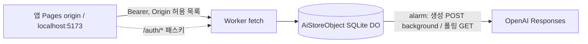

# T-D2 결과 · Worker 프록시·본인 인증·상한·작업 저장소

2026-11-09 · 브랜치 `codex/d02-worker-auth` · **구현 / Claude 자체 검사 통과 / Codex 검토 대기 / 사용자 미확인**

## 요약 (20줄)

1. AI 호출 경로를 `worker/`(Cloudflare Worker, **로컬 `wrangler dev`만**)로 옮겼다. 배포·로그인·계정 작업 0건, 실제 OpenAI 호출 0건.
2. 저장소: SQLite Durable Object 1개(`AiStoreObject`, 이름 `owner`). 표 6개. `jobs.data`는 `toStoredJob` 허용 목록만 통과.
3. 상태 기계: `queued→calling→researching→planning→validating→awaiting-decision|failed|cancelled|unknown|interrupted|expired`. 외부 호출 전 `calling`을 먼저 쓰고, 재진입 시 `calling`+응답 ID 없음이면 `unknown`(재호출 0).
4. OpenAI는 `background:true, store:false`로 만들고 alarm(2초)으로 `GET /responses/{id}` 폴링. HTTP 핸들러는 외부 호출을 기다리지 않는다.
5. G9: 작성 응답 수신 → 사용량과 `validating`을 먼저 저장 → 검사·결과 저장. 결과 쓰기 실패 시 응답 ID가 남아 다음 alarm이 재회수(사용량 중복 0, 단위 시험).
6. 인증: 패스키 등록(1회 코드·자격 0개일 때만, 등록 뒤 코드 영구 폐기) → 로그인(origin·rpId 고정 비교, UV 필수) → HMAC 서명 Bearer 1시간. 해지 `POST /auth/revoke`, 서명 키 교체로 전체 해지.
7. `/api/ai/v2/*` 전부(status 포함) Bearer 필수: 무인증 401 `unauthorized`, 만료 401 `token_expired`, 허용 밖 Origin 403. 쿠키·`Allow-Credentials` 없음.
8. 상한: 본문 512 KiB 초과 413(Content-Length 없어도), 일일 20회 Asia/Seoul 날짜 429 `daily_limit`, 실행 중 1건/여행·전체 2건, 보관 200건(만료 오래된 것부터 삭제), 출력 24시간 뒤 `expired`.
9. 화면: AI 탭에 등록/로그인/토큰 만료 재로그인/로그아웃, "오늘 남은 요청 N/20 · 오늘 사용 토큰", 작업별 토큰 사용량, 폴링 백오프(1~16초 5회) 뒤 "연결 끊김 — 다시 시도". 금액 표시 없음.
10. `VITE_AI_API_BASE`로 기준 주소 분리. 정적 호스팅은 값이 있을 때만 AI 사용. Pages 빌드에는 넣지 않았다(T-D4).
11. `pnpm dev` = Vite 5173 + `wrangler dev` 8787. `pnpm dev:node`로 Node 서버 유지. Node v1은 `OPENAI_V1_ENABLED=1`일 때만.
12. 공통 규칙을 `src/ai-v2-jobs-core.ts`(허용 목록·동의/요청 지문)·`src/ai-v2-openai.ts`(본문·응답 해석)로 올리고 Node·Worker가 같이 쓴다. 계약·의미 검증 규칙 변경 없음.
13. CL-28: 자정을 넘는 낮 이동 구간을 그날 출발 시각으로 승격(시험 1건, 수정 전 실패 확인).
14. 단위: `pnpm run check` exit 0, 434 통과/1 skip. Worker 로직은 `node:sqlite` + 가짜 OpenAI + 소프트웨어 패스키로 실제 `@simplewebauthn/server` 검증을 지난다.
15. E2E: ai-v2 7개 시나리오가 모의 라우트 대신 **wrangler dev + 가짜 OpenAI + CDP 가상 인증기**로 통과(데스크톱·모바일 14). T-D2 전체 흐름 1건 추가. 로컬 전체 E2E 183 통과/5 skip(13.4분).
16. 전송 경계 canary를 Worker 경로에도 적용: 조사·작성 DTO가 Node 경로와 동일, DO 행에 표식 0.
17. 데이터 경계 4경로 diff 0건.
18. CPU(Node 근사): 인증 0.4ms + 파싱 0.8ms + 정규화·지문 2회 약 4~5ms ≈ 6ms(104 KB). workerd 실측 아님 — 여유가 크지 않다.
19. Codex 먼저 볼 위험: 실행 중 요청 원문은 DO **메모리에만** 있어 DO가 내려가면 `interrupted`(유료 호출 낭비 가능). 시험 전용 `/__test/*` 경로.
20. 사용자 결정 필요: 토큰 1시간·일일 20회·등록 코드 전달 방식, 실행 중 원문의 DO 임시 저장 허용 여부.

## 구조

- 로컬: Vite 프록시가 `/api`·`/auth`를 8787로 넘긴다(같은 출처). 교차 출처(`VITE_AI_API_BASE`)는 CORS 허용 origin만.
- 비밀값: `OPENAI_API_KEY`, `TOKEN_SECRET`(32자+), `REGISTRATION_CODE`는 `worker/.dev.vars`(gitignore). `.dev.vars.example`만 커밋.

## §A~F 결과

| 항목 | 상태 | 비고 |
|---|---|---|
| A1 worker/·wrangler.toml·.dev.vars.example | 했다 | `workers_dev=false`, 배포 안 함 |
| A2 src/ai-v2-* 수정 없이 import | **다르게 했다(일부)** | 계약에 상태 enum 3개(§C5 허용)·`aiV2JobLimits`·`aiV2RunningStatuses`·`AiV2ServerStatus` 추가. 규칙 변경 없음. 서버 규칙은 `src/ai-v2-jobs-core.ts`로 올려 Node·Worker 공용 |
| A3 v1 미이식·Node v1 기본 비활성 | 했다 | Worker `/api/ai/jobs` 404, Node 404(`OPENAI_V1_ENABLED=1`이면 열림) |
| A4 `VITE_AI_API_BASE` | 했다 | `aiApiAvailable = 기준 주소 있음 ∨ 정적 호스팅 아님` |
| A5 dev 경로·Node 유지 | 했다 | CL-27(rename EPERM)은 Worker 경로 해당 없음(jobs.json 미사용) |
| B1~B2 등록·로그인·토큰·해지 | 했다 | UV 필수(`requireUserVerification:true`), 챌린지 5분 1회용 |
| B3 Bearer·401/403·CORS | 했다 | Origin 없는 요청(비브라우저)은 통과시키되 Bearer 필수 |
| B4 화면·sessionStorage | 했다 | 로그인 전 미리보기만, 동의·전송 비활성 |
| C1 DO 표 | 했다 | jobs/credentials/daily_counts + challenges/revoked_tokens/settings |
| C2 상태 기계·unknown | 했다 | 생성 호출 연결 실패도 `unknown`(재호출 0) |
| C3 background·alarm | 했다 | 폴링 2초, 작업 상한 15분(초과 시 failed + OpenAI 취소) |
| C4 저장 실패 보존 | 했다 | 단위 시험. DO는 같은 동기 구간 쓰기를 한 번에 확정 |
| C5 24시간 expired·200건 | 했다 | Worker 경로에서 "failed+문구" 우회 제거. Node 경로 호환 유지 |
| C6 usage·상수 | **다르게 했다** | 폴링·상한은 `aiV2Limits`가 아니라 `aiV2JobLimits`에 둠. `aiV2Limits`는 동의 지문(strict schema)에 묶여 필드를 늘리면 기존 동의가 깨진다 |
| D1~D4 | 했다 | 429 안내는 예산/속도 구분 유지 + `daily_limit` |
| E 폴링·라벨 | 했다 | `ai-job-label.ts`에 만료·불명 |
| F CL-28·만료 정리 | 했다 | Worker는 조회·alarm 때 SQL로 만료 대상만 골라 DO에 씀("메모리만 정리" 해당 없음) |

## 저장 필드 (Worker DO)

| 표 | 열 | 담는 것 / 담지 않는 것 |
|---|---|---|
| jobs | id, trip_id, status, fingerprint, response_id, created_at, updated_at, data | data = id·tripId·기준 revision·plan id·status·시각·model·attempt·sources·usage·result(output·sources·검증 scope·warnings)·error. **요청 원문·고른 기록·활동 제목/요약 없음** |
| credentials | id, public_key, counter, transports, created_at | 패스키 공개키만 |
| daily_counts | day(Asia/Seoul), jobs, total_tokens | 금액 없음 |
| challenges / revoked_tokens / settings | 5분 챌린지 / 해지 jti·만료 / `registration_closed` | |

실행 중 요청 원문·조사 본문은 DO 인스턴스 메모리(`JobMemory`)에만 있고 끝나면 지운다.

## 인증 위협 모델

- **쿠키 없음** → 브라우저가 자격을 자동 첨부하지 않으므로 CSRF의 전제가 없다. 공격 페이지는 토큰(sessionStorage, 같은 출처만 읽음)을 얻을 수 없다. Origin 검사는 추가 방어(허용 밖 403, CORS 허용 origin만).
- **Origin·rpId 고정**: WebAuthn 검증의 expectedOrigin = `ALLOWED_ORIGINS`, expectedRPID = `RP_ID`(운영 `jeongjae.github.io`, 로컬 `localhost`). 피싱 출처의 서명은 통과하지 못한다(단위: 다른 origin·rpId 401).
- **토큰 수명** 1시간, HMAC-SHA256, jti 해지 목록. 탈취 시 최대 1시간 + 해지로 즉시 차단. 전체 해지 = `TOKEN_SECRET` 교체.
- **등록 코드**: 자격 0개 + 코드 일치일 때만, 첫 등록 뒤 `registration_closed`로 영구 폐기. 상수 시간 비교. 시도 횟수 제한은 없다(코드는 충분히 길게).
- **시험 경로** `/__test/reset`·`/__test/clock`은 `E2E_RESET=1` **그리고** `RP_ID=localhost`일 때만. 운영 RP ID면 값을 줘도 닫힘(단위 시험).
- 남은 위험: XSS가 생기면 sessionStorage 토큰을 읽을 수 있다(1시간 한정). 계정 복구 수단 없음(패스키 분실 시 DO 자격 초기화가 필요).

## 시험 색인

| 시험 | 대상 |
|---|---|
| `tests/worker-jobs.test.ts` (16) | 외부 호출은 alarm에서만, 전체 흐름·사용량, 허용 목록, 동의 409, 중복·실행 중, calling 재진입 unknown, 연결 실패 unknown, 429 안내, interrupted, 저장 실패 재회수, 수정 재작성, 중단·OpenAI 취소, 시간 상한, 24시간 expired, 200건 정리, Asia/Seoul 경계 |
| `tests/worker-auth.test.ts` (8) | 등록 0개·코드 1회, origin/rpId 불일치, 챌린지 1회, 토큰 만료·해지·키 교체, status 포함 401, Origin 403·CORS, 413(스트림)·415, v1 404·시험 경로 닫힘 |
| `tests/ai-client.test.ts` (4) | 백오프 1·2·4·8·16초 → 연결 끊김, 401 재로그인, Bearer·오류 코드, 만료/불명 라벨 |
| `tests/ai-v2-send-surface.test.ts` (+1) | Worker 경로 canary 동일성, DO 행 표식 0 |
| `tests/ai-v2-day-times.test.ts` (+1) | CL-28 — 수정 전 `expected null to be '22:30'` 실패 확인 |
| `tests/ai-v2.test.ts` (+단언) | Node v1 기본 404 |
| `tests/e2e/ai-v2.spec.ts` | T-D1 7개 시나리오 × 2 = 14, Worker 경로 통과 |
| `tests/e2e/ai-d02-worker.spec.ts` | 등록→로그아웃·로그인→전송→잔여 20→19→폴링→거절→토큰 만료 재로그인→unknown(생성 3회, 재호출 0)→24시간 expired. 가짜가 받은 본문 전부 background·store:false, 예약 표식 0 |

Worker 시험 러너 선택: `@cloudflare/vitest-pool-workers`는 vitest ^4만 지원(현재 5.0.5)이라 쓰지 않았다. 로직은 Node `node:sqlite`로, workerd 동작은 `wrangler dev` E2E로 나눴다.

E2E 진행 중 고친 것: Vite 프록시가 `/auth`를 넘기지 않아 등록 실패 → 프록시 추가. background 왕복으로 저장 대기 5초 초과 → 20초.

## 미검증

실제 Cloudflare 환경(배포·Free CPU 10ms 실측·DO 축출 빈도), 실제 iOS 패스키·교차 출처(Pages→Worker), 실제 OpenAI background + 웹 검색 + 구조화 출력 조합, 원격 CI에서 `wrangler dev` 기동(보고에 결과 기재).

## Codex가 먼저 볼 위험

1. `worker/src/jobs.ts` — 실행 중 원문이 메모리에만 있음 → DO 재시작 시 `interrupted`. 조사·작성 비용이 이미 났을 수 있다.
2. `startCall`의 `calling` 쓰기와 `create` 사이, 사용자 중단이 끼면 응답 ID를 취소 작업에 붙인다 — 경합 처리.
3. `worker/src/app.ts` — Origin 없는 요청 허용(Bearer 필수), `/__test/*` 게이트.
4. `worker/src/auth.ts` — 등록 코드 시도 제한 없음, UV 필수.
5. `daily_counts` 토큰 합계는 결과 쓰기 실패·재회수 경로에서 작업 행과 별개 문장이라 이론상 중복 가능(DO 동기 구간 원자성에 의존).
6. CPU 여유 약 4ms(Node 근사).

## 사용자 결정 필요

- 토큰 수명 1시간, 일일 20회, 본문 512 KiB — 가정 그대로 구현.
- 등록 코드 전달 방식(T-D4에 `wrangler secret`으로 넣고 사용자에게 직접 전달 가정).
- 실행 중 요청 원문의 DO 임시 저장(완료 즉시 삭제)을 허용해 재시작 내성을 높일지 — 현재는 허용 목록 원칙대로 메모리만.
