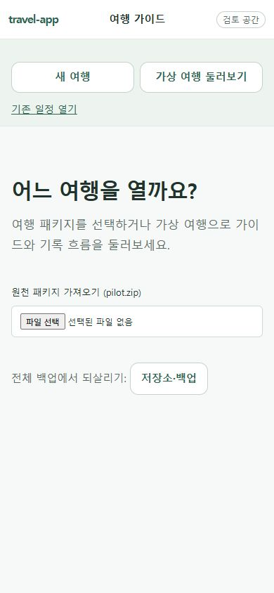
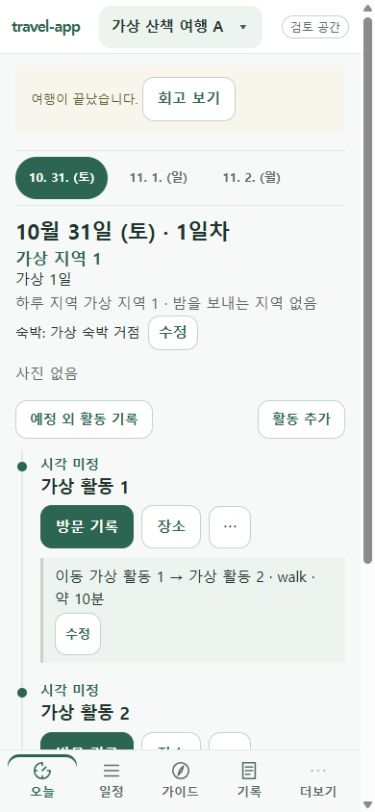
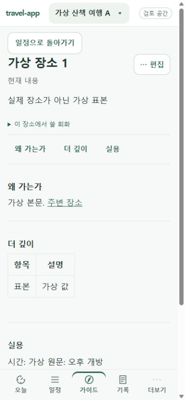
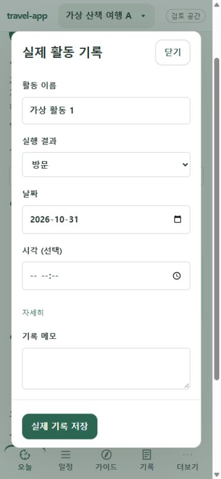
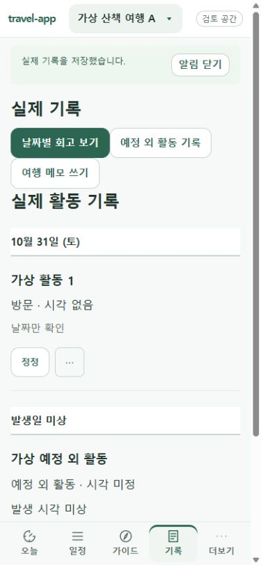
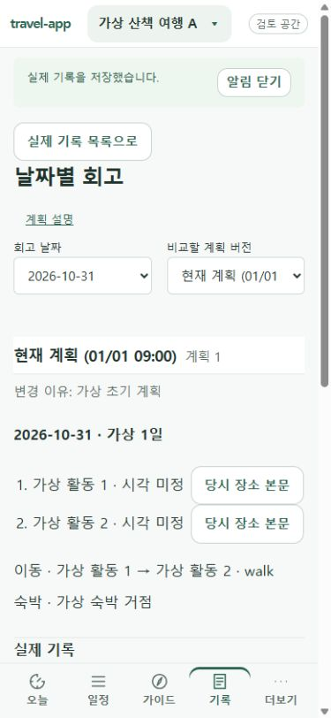

# travel-app UI 개선 설계서

2026-11-06 · v0.1 · **사용자 검토 준비** · 구현 담당 Claude, 독립 검토 Codex

**첫 시제품은 ‘오늘’과 ‘날짜별 회고’ 두 화면으로 제안한다.** 여행 중에는 다음 장소와 이동을 읽고 바로 방문을 남길 수 있어야 한다. 귀가 후에는 같은 활동의 계획과 실제 결과를 한눈에 비교할 수 있어야 한다. 두 화면에서 읽는 순서를 검증한 뒤 같은 규칙을 가이드와 여행 시작 화면으로 확장한다. [두 화면 시안 열기](ui-review-2026-11-06/concept.html)

## 1. 무엇을 기준으로 검토했나

코드 기준은 C-15 R1이 병합된 `main`의 `e0c4013`이다. 실행 관찰은 11월 6일 Pages의 별도 검토 공간에서 390 × 844 뷰포트와 공개 가상 표본 A로 수행했다. 표본의 여행 기간은 이미 끝났다. 화면에서 본 사실, 코드에서 확인한 조건, 아래 제안을 구분한다. iPhone 실기기, 평소 공간, 43일 여행, 오프라인 재시작은 이번 실행의 대상 밖이다. 접근성 적합성 및 소요 시간도 별도 측정 대상이다.

| 순서 | 실제 화면과 관찰 | 개선 우선순위 |
| --- | --- | --- |
| 1. 시작 | ‘새 여행’과 ‘가상 여행 둘러보기’가 제목 위에 있고, 제목 아래의 큰 영역은 원천 ZIP 입력에 쓰인다. 복원 진입점은 따로 보인다. | P1. 처음 쓰는 사람에게 생성·체험을 한곳에 제시하고 가져오기와 복원을 목적별로 구분한다. |
| 2. 오늘 | 날짜 띠, 활동 제목과 방문 버튼은 찾기 쉽다. 한 이동을 설명하면서 양 끝 활동 이름을 반복하고 `walk`를 그대로 표시한다. 숙박과 이동 각각에 ‘수정’이 보인다. | P0. 날짜 → 다음 활동 → 이동 순서를 강조하고 편집은 맥락 메뉴에 모은다. |
| 3. 장소 | ‘장소’로 상세를 열고 ‘일정으로 돌아가기’로 복귀할 수 있다. 본문 목차와 회화가 있다. 화면 위쪽에는 편집 버튼, ‘현재 내용’, 소개, 회화, 목차가 연달아 나온다. | P1. 장소명과 방문에 필요한 내용을 앞에 둔다. 출처·당시 본문·복귀 경로를 보존한다. |
| 4. 방문 입력 | 표본 A에서 ‘방문 기록’을 누르면 날짜가 채워진 폼이 열린다. 시각 입력과 ‘자세히’가 분리되고 저장 버튼이 하단에 보인다. | P0. 바로 저장할 때와 입력이 필요할 때 버튼 이름을 구분한다. 저장 실패와 재시도 상태도 설계한다. |
| 5. 기록 | 저장 뒤 목록에 방문이 나타났다. ‘실제 기록’과 ‘실제 활동 기록’ 사이에 세 버튼이 두 줄로 놓인다. 시각 정보는 ‘시각 없음’과 ‘날짜만 확인’ 두 줄이다. | P1. 목록·회고 전환과 새 기록 작성을 분리하고 시간 정밀도는 한 문구로 읽히게 한다. |
| 6. 회고 | 날짜와 계획 버전을 고른 뒤 계획 전문이 먼저 나온다. 이 표본의 첫 화면에서는 ‘실제 기록’ 제목만 하단에 보인다. | P0. 날짜·비교 버전 바로 밑에서 실제 결과를 읽고, 계획과 연결된 활동별로 비교하게 한다. |

검토 순서대로 실제 화면 6장 보기

| 1. 시작 | 2. 오늘 | 3. 장소 |
| --- | --- | --- |
|  |  |  |

| 4. 방문 입력 | 5. 기록 | 6. 회고 |
| --- | --- | --- |
|  |  |  |

## 2. 상용 앱에서 가져올 원리

| 참고 근거 | travel-app에 적용할 판단 | 이번 범위 |
| --- | --- | --- |
| 트리플은 사진·글에서 관심 장소로 이어지는 탐색을 설계했다. 기존 트리플은 NOL 통합을 공지했으므로 공개 당시의 패턴을 참고한다. [운영사의 트리플 홈 설명](https://www.yanoljagroup.com/ko/press_release/view?id=1468) · [사업자 제공 앱 변경 이력](https://apps.apple.com/us/app/id1225499481) | 사진을 누가, 어디에서 찍었는지 장소 이름과 함께 보여 준다. 일정에서 읽던 장소 안내를 열었다가 같은 날짜·활동으로 돌아온다. | C-15 대표 사진 순위와 활동 목록 위 배치를 따른다. 피드와 외부 사진 수집은 제외한다. |
| Wanderlog는 일정과 지도를 한 화면에 두어 장소의 순서와 위치를 함께 판단하게 한다. [공식 제품 소개](https://wanderlog.com/) | 예약된 다음 장소까지 어떤 이동이 필요한지 일정 안에서 읽게 한다. 인접 활동은 ‘도보 약 10분’, 건너뛰는 연결은 양 끝 장소를 명시한다. | 저장된 이동 정보와 기존 외부 지도 링크를 사용한다. 신규 지도 SDK·위치 권한·경로 계산은 후속 결정이다. |

두 서비스의 로그인 후 화면이나 오프라인 성능을 직접 비교한 결과는 아니다. 기존 [프로젝트 벤치마크](여행계획앱%20벤치마킹%20Triple%20vs%20Wanderlog.md)의 지도 분할 제안 중 이번에 채택하는 부분은 일정과 장소의 선택 맥락이다. 현장에 필요한 순서·시간·이동은 통신 없이 읽을 수 있어야 한다.

## 3. 화면별 동작 명세

| 화면 | 처음 보일 내용과 주 동작 | 상세·예외·복귀 |
| --- | --- | --- |
| 여행 시작·전환 | 빈 공간에서는 ‘새 여행 만들기’를 주 버튼, ‘가상 여행 둘러보기’를 보조로 배치한다. 여행이 있으면 최근 열어 본 여행 제목으로 전환 목록을 연다. | ‘여행 패키지 가져오기’와 ‘전체 백업 복원’을 별도 행에 둔다. 복원 불가 시 현재 여행 수·이유·‘새 빈 공간 열기’를 보인다. |
| 오늘 | 날짜 띠 → 날짜·지역·활동 수 → 해당 날짜의 타임라인. 여행 중 오늘에 한해 기존 판정이 제공하는 현재·다음 활동을 강조한다. 예약 시각 등 현장에 필요한 정보는 활동 바로 아래에 둔다. | 과거·미래 날짜는 ‘다음’으로 오인시키지 않는다. 여행 종료 안내는 짧은 ‘회고 보기’ 행으로 둔다. 사진이 있으면 활동 위에 대표 사진과 기존 사진 띠를 둔다. 사진이 없으면 빈 이미지 영역 없이 타임라인을 올린다. |
| 일정 | 전체 일정의 날짜행은 일차·날짜, 지역, 핵심 활동, 숙박 순서. 행 선택은 기존처럼 ‘오늘’의 해당 날짜로 연결한다. | 긴 여행은 날짜 직접 선택을 제공한다. 현재 선택 일자를 목록에 다시 표시한다. 활동이 없는 날에도 날짜를 선택해 ‘활동 추가’를 누를 수 있다. |
| 장소·가이드 | 장소명 → 방문에 필요한 요약 → 해당 장소 회화와 본문 목차 → 상세 본문. 연결 상태가 확인된 지도 대상만 외부 지도를 연다. | 지역·준비·회화에서 들어오면 원래 목록, 일정에서 들어오면 같은 날짜·활동·스크롤 위치로 복귀한다. 역사 버전에는 ‘당시 내용’ 표시. 본문이 없으면 보유한 정보와 복귀 동작만 보여 준다. |
| 방문·기록 | 확인된 여행 시간대의 ‘방문 기록’은 한 번 눌러 현재 현지 시각으로 저장한다. 시간대가 미확정이면 ‘방문 입력’으로 날짜·시각 폼을 연다. 기록 탭에는 날짜 그룹과 ‘목록 / 회고’ 전환을 둔다. | 저장 중 재입력을 막고 성공 후 카드 상태와 정정 경로를 보여 준다. 실패 시 원인과 입력을 유지하고 성공으로 표시하지 않는다. 정정 전 원문·발생일 미상·예정 외 활동은 기존 분류를 따른다. |
| 회고 | 선택 날짜와 계획 버전 → 방문·건너뜀·예정 외 요약 → 활동별 계획과 실제 → 변경 이유·근거 순. 비교 행에는 계획 시각과 실제 결과를 각각 표시한다. | 선택한 계획과 기록 당시 계획이 다르면 양쪽 버전을 명시한다. 기록 없는 계획은 ‘기록 없음’으로 쓴다. 예정 외·날짜 정정·연결할 활동이 없는 기록은 별도 행으로 보존한다. 당시 본문과 변경 근거를 다시 열 수 있다. |
| 더보기 | 저장소·백업, 예약·할 일, 준비·회화 등 기존 항목을 사용자 목적별로 묶는다. 백업 생성·복원은 한 그룹 안에서 동사를 구분한다. | 계획 변경안은 차이·기준 버전·확인 후 적용 흐름을 따른다. 공개·동기화·실제 AI 실행은 이 UI 작업 범위 밖이다. |

**표시와 데이터의 경계.** ‘오늘’은 선택 날짜의 상세이고 ‘일정’은 전체 날짜 목록이라는 기존 탭 의미를 유지한다. 이동수단은 알려진 값만 한국어로 표시하고 입력한 자유 문구는 그대로 둔다. 시각 미정과 날짜만 확인을 구별한다. 회고는 기존 버전·활동 ID·정정 체인으로 연결한다. 제목이 같거나 수정 횟수가 많아도 임의 연결이나 중복 집계를 하지 않는다. 모든 저장은 기존 명령과 revision 검사를 거친다.

## 4. 시각 규칙과 반응형

- **읽는 순서.** 날짜 제목 24px, 활동·섹션 제목 18~20px, 본문 16~17px, 보조 정보 14px를 기준으로 한다. 시각 숫자 폭을 맞추고 장소명이 길면 두 줄 이상 허용한다. 4·8·12·16·24px 간격을 쓰며 이동 구간의 여백은 활동 사이보다 좁게 둔다.
- **색과 재질.** 기존 배경 `#F6F9F7`, 본문 `#20332D`, 주 동작 `#2D6553`, 선택 배경 `#EDF4EF`를 재사용한다. 현재 활동에만 채운 방문 버튼을 강조하고 나머지 활동에서도 방문 기록에 직접 접근할 수 있게 한다. 방문·건너뜀·미상은 글자로도 식별한다.
- **모바일.** 좌우 여백 16px, 단일 열, 하단 다섯 탭 유지. 날짜 띠와 저장 버튼은 고정 영역에 가려지지 않아야 한다. 키보드가 열린 폼도 마지막 입력·저장·닫기까지 접근할 수 있게 한다.
- **넓은 화면.** 700px 이하는 단일 열을 기본으로 하고 1024px 이상은 일정 목록과 선택한 장소를 좌우로 배치할 수 있다. 회고는 같은 활동의 계획·실제를 나란히 둔다. 중간 폭·200% 확대에서는 공간이 부족하면 단일 열로 돌아간다. 본문 한 줄은 약 65자 이내를 목표로 한다.
- **접근성 검수값.** 주요 조작 영역은 최소 44 × 44 CSS px, 일반 글자 명암비 4.5:1 이상을 목표로 한다. 선택 날짜·현재 탭을 보조 기술에 전달하고, 저장 결과를 상태 영역에서 한 번 알린다. 상세·모달 복귀 시 호출 항목으로 포커스를 돌린다. 이 값은 구현 후 측정할 기준이다.

## 5. 구현 단위와 수용 기준

| 순서·담당 범위 | 확인할 실제 산출물 | 통과 기준 |
| --- | --- | --- |
| A. 오늘·회고 시제품. `Journey`, `DayDetails`, `Retrospective`, `journey.css` 중심 | 같은 가상 여행의 390px·PC 전후 화면과 클릭 가능한 시제품. 사진 0장·여러 장을 함께 제출 | 종료 여행의 회고에서 첫 뷰포트에 방문 요약이 보인다. 첫 활동에서 장소를 한 번에 열고 복귀하면 원래 날짜·활동으로 돌아온다. 인접 이동은 한 줄로 읽히고 비인접 이동의 양 끝은 남는다. 사용자에게 두 화면을 먼저 보여 준다. |
| B. 시작·전체 일정·가이드·기록. `ContentApp`, `GuideList`, `Guide`, `Field` 중심 | 빈 공간, 긴 일정, 긴 한글 제목, 방문 입력 및 정정, 여행 전환의 PC·모바일 증거 | 43일 **가상** 표본에서 마지막 날짜를 직접 선택할 수 있다. 시간대 확인 시 한 번 저장, 미확정 시 폼, 충돌·실패 시 오류와 복구 경로. 키보드만으로 모든 주요 동작과 복귀가 가능하다. |
| C. 회귀와 사용자 확인 | 가상 삿포로 대본, 작은 폭 320px·390px·PC, 오프라인 재시작과 백업 복원 결과 | 일반 본문 가로 넘침 0건. 오프라인 일정·기록 유지, 빈 공간 복원 전후 여행별 내용 일치, 역사 revision·정정 체인·변경안 확인 유지. 실기기는 사용자 별도 확인으로 기록한다. |

각 단위는 Claude가 화면·상태별 증거와 검사 결과를 제출하고 Codex가 위험 부분을 독립 검토한다. 구현 시 `pnpm run check`(빌드 포함)와 `pnpm run test:e2e`를 수행한다. [U4 시나리오](../u4-sapporo-scenario.md), [C-15 사진·본문 기준](../claude-task-c15-result.md), [기존 UI 정리 계획](../ui-polish-plan.md)을 회귀 기준으로 사용한다. 검토는 새 격리 공간과 가상 자료로 한다. 43일 실여행·iPhone·사용자 확인 결과는 별도로 받는다.

**검토할 결정.** [시안](ui-review-2026-11-06/concept.html)의 ‘오늘’에서 이동을 활동 두 개 사이에 두는 방식과 ‘회고’에서 실제 결과를 위로 올리는 방식을 먼저 확인해 주시면 된다. 시안은 설명용 정적 화면이며 앱 동작과 사용자 승인 여부는 각각 별도로 검증한다.
