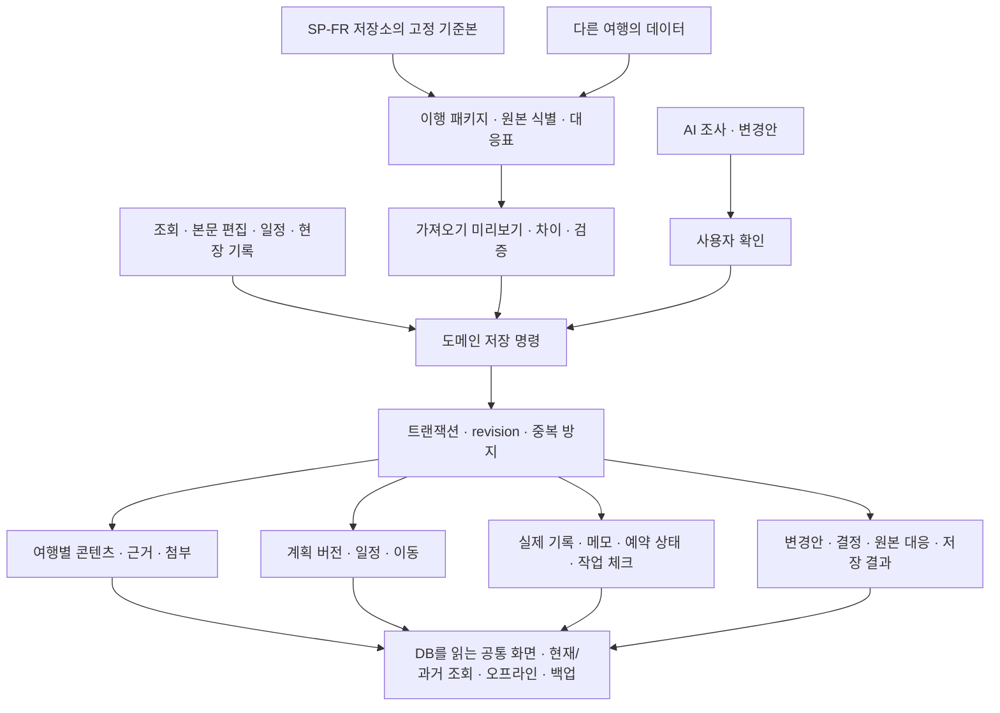

# travel-app 공통 데이터 구조와 정본·편집 책임

작성일: 2026-10-21 · 상태: 설계 검토 초안 v0.3 · 콘텐츠 DB화·공통 프로그램 전환을 이행 중심 목표로 명시

이 문서는 목표 구조의 제안이다. 사용자 확정 요구를 충족하는 방법을 구체화하며, 새로운 정책 선택·논리 모델·저장 구조는 구현되거나 합의된 것으로 간주하지 않는다. 앱 코드·DB·교환 형식은 변경하지 않았다. 현재 프로토타입 구조는 [data-model.md](data-model.md)에 별도로 보존한다. 후속 기술 비교·선정안은 [technology-selection.md](technology-selection.md)에 있으며 아래 기술 대안을 구체화한다.

## 1. 설계의 입력과 이번 결정 범위

확정 요구: 개인용·모바일 우선, 여러 여행, 계획/실제/변경안 분리, 오프라인 조회·현장 기록·백업, 앱 내부 OpenAI API 실행, 모든 AI 변경안 확인 후 적용.

이행 정책: 가이드북 조회·핵심 현장 사용과 기존 장소 본문 편집을 이행한다. 새 가이드 작성·내장 지도 조작은 이후 확장하며 지도는 장소·동선 목록과 외부 링크 우선이다. 저장소 원본만 이행하고 기존 기기 DB·저널·캐시·자격증명은 추출하지 않는다.

이번 설계에서 후속 사용자 확정:

1. 같은 장소를 여러 여행에서 사용해도 여행별 독립 사본으로 관리한다. 한 여행의 편집을 다른 여행에 자동 반영하지 않는다.
2. 이행 후 콘텐츠는 travel-app에서 관리한다. SP-FR은 읽기 원본으로 보존하며 재가져오기는 차이를 확인한 뒤 적용한다.

위 두 정책은 사용자 확정이며 아래 논리 엔티티·버전 관리·시간·트랜잭션·패키지 방식은 설계 제안이다. 원본의 파일별 범위는 [migration-inventory.md](migration-inventory.md)의 추가 조사가 필요하다.

### 이행의 중심 목표 — 사용자 명확화 반영

**기존 콘텐츠를 코드 안의 값까지 포함해 데이터화하고, 매번 다른 여행계획을 DB에 저장해 공통 프로그램으로 조회·편집하는 구조로 전환한다.** SP-FR은 그 구조를 검증하는 첫 여행 데이터다. 기존 정적 페이지의 사용자 가치를 DB 조회·공통 화면·저장 명령으로 제공하는 것이 이행 작업의 중심이다.

`원고·XLSX·JSON·코드에 포함된 여행 콘텐츠 → 추출·구조화·검증 → 여행별 DB → 공통 조회·편집 프로그램 → 여행별 화면`

| 분리할 대상 | DB/자료로 옮길 것 | 프로그램이 담당할 것 |
|---|---|---|
| 여행·지역·장소·일정 | 여행 기간·도시·장소 설명·방문 순서·이동·관련 자료와 관계 | 여행 선택, 검색·탐색, 데이터 기반 목록·상세·일정 표시 |
| 코드 안 예약·준비 콘텐츠 | 특정 여행의 예약 레코드·기한·주의·대안·국가별 안내 등 | 일반적인 상태 표시·필터·유효성 검사. 특정 도시/예약명을 조건으로 한 예외는 대응 데이터와 일반 규칙으로 분리 |
| 본문·사실·출처 | 설명은 섹션별 본문, 운영시간/요금 등은 구조화된 사실·근거 | 공통 본문 표시·편집, 사실 참조 해석·검증. 긴 본문을 문장마다 별도 테이블로 나눌 필요는 없음 |
| 이미지·지도/PDF 등 | DB의 메타데이터·연결·크레딧과 별도 관리 가능한 첨부 바이트 | 자료 열기·로컬 저장·누락 확인·백업/복원 |
| 페이지 레이아웃·동작 | 여행별 표시 설정이 있으면 검증된 설정 데이터 | 공통 화면·입력·저장·시간/참조 검증. 일반 UI 문구·알고리즘을 모두 콘텐츠 DB로 옮기자는 뜻은 아님 |

앱 실행 시 화면은 선택한 여행의 DB 내용을 읽는다. 새 여행을 추가하거나 기존 콘텐츠를 편집한 결과는 데이터 저장 후 화면에 반영하며, 여행별 HTML을 다시 만들거나 특정 여행용 화면 코드를 수정하는 것을 일상 운영 절차로 요구하지 않는다. 앱 자체의 코드 변경·배포와 여행 콘텐츠의 변경을 구분한다. 원래 HTML은 비교 자료로 사용할 수 있지만 HTML 파일 묶음만 DB에 넣고 링크하는 방식으로 프로그램 전환이 완료된 것으로 보지 않는다.

초기 단계에서도 합의한 형식으로 새 여행 데이터를 가져와 같은 DB 모델과 화면에 연결할 수 있어야 한다. 풍부한 새 가이드 작성 UI를 이후 확장한다는 결정은 이 범용 DB·화면 구조를 미루는 뜻이 아니다. DB 제품과 서버/로컬 저장 위치는 별도 기술 선택이다.

## 2. 구조 개요 — 제안

DB는 현재 저장 결과의 기준이고, 검색 색인·화면·오프라인 준비 상태는 그 결과를 바탕으로 만든다. 화면이나 AI가 저장소를 직접 덮어쓰지 않는다. Mermaid의 각 상자는 책임을 구분한 것이며 각각 독립 서버를 만들자는 뜻이 아니다.

## 3. 무엇을 정본으로 삼는가 — 제안

| 정보 | 저장·편집 기준 | 이력과 다른 정보에 미치는 영향 |
|---|---|---|
| 가져온 SP-FR 자료 | 선택 commit·파일 해시로 식별한 읽기 전용 기준본 | 비교/재가져오기 근거다. 앱 편집을 원본 저장소로 자동 되쓰지 않음 |
| 여행 정보·장소·지역·가이드 본문 | 앱에서 마지막으로 저장한 유효 콘텐츠 revision | 이전 revision 보존. 다른 여행이나 과거 계획의 고정 값을 자동 변경하지 않음 |
| 현재 계획 | 명시적으로 선택된 최신 PlanVersion | 과거 버전은 불변. 콘텐츠 설명의 수정과 일정 시각/순서의 수정은 별도 명령 |
| 실제 활동 | 추가식 ActualRecord와 정정 연결 | 원래 계획·수정된 계획과 독립. 과거 기록을 지우는 대신 정정 기록 추가 |
| 메모·작업 체크·예약 상태 | 대상과 시점을 가진 운영 기록 | 방문 사실·외부 예약의 실제 변경과 구분. 기존 상태·수정 전 상태 보존 |
| 사실·근거 | 값과 출처·확인 시점·확인 상태를 묶은 revision | 가져온 시각을 사실 확인 시각으로 쓰지 않음. AI 수집 자체를 검증 완료로 간주하지 않음 |
| AI 또는 가져오기 변경안 | 적용 전의 별도 초안과 사용자 결정 | 저장된 초안은 현재 콘텐츠/계획이 아님. 승인·검증·원자 적용 뒤에만 유효 데이터 변경 |
| 첨부 | 콘텐츠 해시·원본 출처·크레딧·로컬 바이트 | 캐시 삭제가 참조 원본 변경을 뜻하지 않음. 누락 파일을 조용히 생략하지 않음 |

이행 후 편집 기준은 사용자 선택에 따라 travel-app이다. SP-FR 원고로의 자동 되쓰기나 양방향 자동 동기화를 제공하는 것으로 해석하지 않는다. 필요할 때 새 원본을 명시적으로 재가져오고 앱 편집과 차이를 검토할 경로는 유지한다.

## 4. 논리 데이터 모델 — 저장 테이블 확정 전

논리 엔티티는 도메인의 의미다. 표의 모든 항목을 각각 별도 DB 테이블로 만들 필요는 없다.

후속 구체화는 [원천 콘텐츠→DB→공통 화면 설계](content-db-mapping.md) v0.1에 있다. D-01~23의 논리 컬렉션·주요 필드, P-01~25의 원천 변환·관계, V-01~11의 화면 조회/저장 대응을 제안했다. 물리 DB와 실제 스키마를 생성한 것은 아니다.

| 묶음 | 엔티티·핵심 정보 | 관계와 경계 |
|---|---|---|
| 여행 | Trip: id, 이름, 기간, 기본 시간대, revision, 현재 계획 ID | 다른 객체의 tripId와 일치. 기본 시간대는 명시적 입력의 기본값이며 원본의 모르는 시간대를 자동 확정하는 근거는 아님 |
| 콘텐츠 식별 | Place·Region·GuideDocument: 여행 범위 ID, 종류, 원본 대응 | 장소 자체와 특정 날짜의 방문 계획을 구분. 지역 가이드·회화·준비 안내도 같은 콘텐츠 문서 체계에서 표현 가능 |
| 콘텐츠 본문 | ContentRevision: 문서/장소 ID, revision ID, 섹션별 Markdown, 메타데이터, 첨부/근거 참조, 저장 당시 factBindings, 작성 주체·저장 시각 | 현재 포인터와 불변 revision을 구분. 초기에는 기존 장소의 왜 가는가·더 깊이·실용 편집을 제공 |
| 계획 | PlanVersion: 버전 ID·번호, 이전 버전, 이유, 활동/일별 정보/이동 스냅샷, 관련 콘텐츠·Fact·근거·예약 revision 참조 | 과거 계획의 제목·순서·시각·대상 관계는 그대로 유지. 거부한 변경안은 새 계획을 만들지 않음 |
| 계획 활동 | PlannedActivity: 안정 ID, dayId/순서, 제목, 장소 관계, 계획 TimeSpec, 메모·선택/실행 의미·예약 참조 | 같은 장소의 재방문은 별도 활동 ID. 장소를 참조하지 않는 이동·식사 슬롯도 표현 |
| 하루·이동 | PlanDay·PlanLeg: 날짜·도시·일 유형·식사/교통·우천 대안·검토 사항, 활동 간 연결·수단·소요/거리 원문 | 순서는 정확한 시작 시각이 없는 활동에서도 명시적으로 유지. 출발/도착 정보와 계획·실제 이동을 혼동하지 않음 |
| 실제 활동 | ActualRecord: id, 제목/대상 요약, 선택적 원본 활동·계획 버전·장소 참조, 실제 TimeSpec, 결과·메모, recordedAt, supersedes | 예정 외 활동은 계획 참조 없이 생성. 계획 제거 후에도 기록과 당시 대상 요약 유지 |
| 기존 현장 상태 | ImportedFieldState: 원본 키, 체크/메모/원본 편집 정보, provenance | 저장소에 존재하는 자료만 분류. 과거 visited 값을 시각이 있는 실제 방문으로 자동 변환하지 않음 |
| 메모 | NoteEntry: 대상 종류·ID·선택적 revision, 본문, 기록 시각·정정 연결 | 하루/일정/장소/예약 메모의 대상을 유지. 메모 시각을 활동 시각으로 사용하지 않음 |
| 예약·숙박 | Booking 및 BookingRevision: 종류·대상·기간/시각·관련 일정·상태·행동·주의/대안·출처 | 상태는 사용자 관리 정보다. 예약 사이트에 예약·취소를 실행하는 명령과 분리. 공개 대상과 개인 필드 구분 |
| 실행 작업 | TaskDefinition·TaskStateEntry: 안정 작업 ID, 정의 revision, 대상·해야 할 일·완료 기록 | 문구 일부를 ID로 쓰지 않음. 작업 의미가 달라지면 기존 완료 표시를 자동 승계하지 않음 |
| 사실·출처 | FactRevision·Evidence: 주장/값, 대상, 출처, 원본 신뢰/확인일·재확인일/적용 기간, 앱 검토 상태 | 장소 운영시간과 계획 변경 이유의 근거를 연결 가능. 원본이 주장한 확인 상태와 앱에서 새로 검토한 상태 구분 |
| 첨부 | Asset: id, 해시, 타입·크기, 원본 참조, 크레딧, 로컬 보관 상태 | 이미지·카드·지도/PDF 자료 등. 프로그램 소스에 실제 여행 파일을 포함시키지 않음 |
| 변경안 | ChangeSet/Proposal: origin, baseRevision, 기준 계획·콘텐츠 revision, 연산, 근거·이유·영향, 상태·사용자 결정 | AI·재가져오기 모두 검증 경로를 공유 가능. AI는 실제 기록을 고치는 연산을 받지 않음 |
| 이행 근거 | ImportPackage·SourceSnapshot·ImportMapping: 원본 commit/파일 해시/변환기 버전, 원본 키↔대상 ID, 마지막 반영 기준 B의 정규화 값 또는 로컬 불변 스냅샷 참조 | 동일 원본 재시도와 새로운 원본 갱신을 구분. 원본 서버 접근 없이 비교 기준 내용을 읽을 수 있어야 함. sourceRefs 자유 텍스트를 검증된 웹 사실로 승격하지 않음 |
| 저장 이력 | CommandReceipt: 요청 ID, 명령 종류·입력 fingerprint, 적용 결과 참조 | 같은 요청 재시도로 콘텐츠 revision·계획·기록이 중복되지 않음 |

장소 관계는 visit/context/transit/nearby와 원본 보조 참조를 보존한다. 계획의 방문 참조, 관련 안내 링크, 실제 방문 기록은 서로 다른 관계다. 원본 스키마와 renderer의 방문일 처리 차이는 표본을 확인해 변환 규칙에 명시한다.

### 여행 간 재사용 — 독립 사본 사용자 확정

다른 여행으로 가져오거나 복사할 때 콘텐츠를 여행별 독립 사본으로 만든다. 원본 장소 slug·출처는 추적하되 `(tripId, entityId)`로 격리하고, 여행 A의 편집이 여행 B에 자동 적용되지 않는다. 첨부 바이트의 중복 제거는 가능하지만 편집 대상의 소유권과는 별개다. 복사는 현재 승인된 revision을 새 여행에 명시적으로 추가하는 동작으로 설계하며 기존 여행을 연결 포인터로 공유하지 않는다.

비교한 대안은 PlaceLibrary의 설명을 여러 여행이 공유하는 방식이었다. 사용자 선택에 따라 초기 공통 구조에는 공유 편집·여행 간 자동 갱신을 넣지 않는다. 이후 공유 라이브러리를 도입하려면 별도 요구 변경과 revision/충돌 정책 재검토가 필요하다.

## 5. 과거 자료가 최신 편집 때문에 바뀌지 않게 하는 방법

1. 현재 가이드 열람은 현재 ContentRevision을 보여준다. 본문 저장은 콘텐츠 revision만 새로 만들며 계획의 시각·제목·순서를 자동 수정하지 않는다.
2. PlanVersion은 활동 자체의 값을 스냅샷으로 보관하고, 저장 당시 연결된 콘텐츠·근거의 revision을 contentRefs로 보관한다. 과거 계획에서는 당시 값/당시 설명을 열 수 있다.
3. 현재 계획에서 연결 가이드를 열면 최신 설명을 볼 수 있지만 과거 계획·기록의 당시 설명과 구분해서 표시한다. 모든 본문 편집마다 계획 버전을 생성할 필요는 없다.
4. 실제 기록 생성 시 활동 제목·대상 요약과 원본 계획 버전 및 관련 contentRefs를 남긴다. 새 계획에서 활동을 제거하거나 장소 이름을 바꿔도 실제 기록은 조회된다.
5. 활동·장소·첨부를 참조하는 이력이 남아 있으면 물리 삭제로 참조를 깨지 않는다. 비활성화 또는 새 revision을 사용한다. 사용자가 데이터를 완전 삭제하는 정책은 별도 정의한다.

contentRefs는 본문 revision ID만 뜻하지 않는다. 해당 표시를 재현하는 FactRevision·Evidence·BookingRevision·첨부 등 필요한 전이 참조를 불변 revision/해시로 고정한다. 과거 조회에서 토큰·링크가 최신 head를 암묵적으로 따라가지 않는다. 같은 본문을 저장하지 않고 Fact만 갱신해도 이전 계획·기록의 당시 값은 보존한다.

콘텐츠 revision만으로 변경 이유가 추적되는 것은 아니다. 각 저장에는 사용자/AI/가져오기 주체, 대상, 기록 시각, 요청 ID와 필요 시 변경 이유를 연결한다. 전체 이벤트 소싱을 도입해야 한다는 요구는 아니다.

## 6. 시각 미정과 실제 기록 — TimeSpec 제안

일정 순서와 정확한 시각을 독립시킨다. 기록을 저장한 시각 recordedAt과 실제 활동 시각 occurredTime도 구분한다.

| 원본/입력 | 표현 | 금지할 추정 |
|---|---|---|
| 날짜와 방문 순서만 있음 | 날짜+순서, 시각 precision=unspecified | 자정이나 일정 간격으로 가짜 시각 생성 |
| ‘오전’, ‘점심 후’, 시간 범위 등의 자유 문구 | rawText를 유지하고 precision=text. 범위 구조화는 명시적 해석/검토 후 | 임의의 분 단위 시각으로 자동 치환 |
| 날짜·현지 시각이 있으나 시간대 미확인 | precision=local, 날짜·현지 시각과 미확인 상태 | 기기 현재 시간대로 UTC 계산 |
| 날짜·현지 시각·IANA 시간대·오프셋이 확인됨 | precision=instant, 현지 표현과 instant를 함께 보존 | DST 중복/없는 시각을 무단 보정 |
| 출발·도착 날짜/시간대가 다름 | 시작·종료 각각 TimeSpec. 날짜 이월과 해석 근거 기록 | 모든 이동 시각을 출발 시간대 하나로 표시 |
| 실제 방문 체크는 있지만 시각 없음 | 날짜가 확인되면 date 정밀도, 아니면 미상. 기존 원본은 ImportedFieldState로 유지 | 편집 시각을 방문 시각으로 변환하거나 visited=false를 건너뜀으로 단정 |

TimeSpec의 논리 필드는 precision, date, localTime, timeZone, offset/instant, rawText, 해석 근거다. precision에 따라 허용 필드 조합을 검증하며 중복된 값이 충돌하면 저장하지 않는다. 시간 구간의 시작·종료는 각각 표현하고 종료 미정도 허용한다.

일정 화면은 dayId와 명시적 순서로 정렬한다. 실제 타임라인은 확인된 발생 날짜·시각으로 정렬하되 시각 미상 항목은 별도 영역/동일 날짜의 순서로 표시한다. 다른 정밀도 항목에 거짓 시간순을 부여하지 않는다. 날짜조차 모르면 ‘발생일 미상’이며 계획 날짜를 실제 날짜로 자동 대입하지 않는다.

명확한 원본 규칙이 확인되지 않은 `종료 < 시작`은 자정 넘김이라고 단정하지 않는다. 날짜 이월을 확인하거나 검토 필요로 남긴다. 출발/도착 시간대의 구체적 입력 화면은 단계별 구현 범위와 별개로 모델에서 표현 가능하게 한다.

## 7. 본문 편집·사실·예약의 책임

- 기존 Markdown 본문과 섹션을 보존하고 섹션 편집+미리보기를 초기 후보로 삼는다. 임의 HTML·스크립트를 실행하지 않고, 링크·첨부·fact 참조를 허용된 형태로 검증한다. 편집기 제품/라이브러리는 아직 정하지 않는다.
- `{{fact:...}}`는 단순 문자열 치환 뒤 원문을 버리는 방식으로 가져오지 않는다. 원본 토큰과 대응 Fact ID를 보존한다. 최신 가이드는 현재 승인된 Fact head를 사용하되, 콘텐츠 revision 자체의 과거 조회는 저장 당시 factBindings를, 과거 계획·실제 기록은 해당 context/contentRefs에 고정된 FactRevision을 사용한다. 다른 시점의 값이 표시되면 그 맥락을 구분한다. 미해결 토큰은 가져오기 검토에 표시한다.
- 사용자가 설명을 고친다고 운영시간 Fact가 자동으로 ‘검증됨’이 되지 않는다. 본문과 구조화 사실을 함께 바꿀 때는 서로 다른 변경 대상을 보여주고 같은 도메인 명령에서 일관성을 검증한다.
- 예약/숙박 상태는 PlanVersion에 섞어 일정을 옮길 때 덮어쓰지 않는다. 계획은 예약을 참조하고, 예약 revision을 바꾸면 영향을 받는 계획/AI 컨텍스트도 갱신 대상으로 본다.
- 예약 여부·할 일·방문 여부는 서로 다른 값이다. 새 계획으로 대체되거나 작업 내용이 달라진 뒤 완료 체크를 유지할지는 작업 정의 revision을 기준으로 판단한다.
- 앱 내부 본문 편집은 로컬 저장 경로를 쓰는 안이다. 오프라인 본문 편집의 제품 범위와 편집 취소/저장 UX는 아직 별도 확정되지 않았다. 확정된 오프라인 현장 기록은 이 결정에 영향받지 않는다.

## 8. 최초 가져오기와 재가져오기

### 최초 가져오기

1. 저장소의 선택 commit을 식별하고 사용할 파일·코드 안 콘텐츠·첨부를 읽는다. 실제 값은 Git 추적하지 않는 사용자 자료로 다룬다. 원본 빌드가 파일을 다시 쓰는 경로는 사용하지 않는다.
2. ImportPackage에 manifest, 변환된 구조 데이터, 필요한 첨부, 원본 참조/해시와 손실·불확실성 보고서를 묶는다. 새 앱은 SP-FR 전용 경로를 UI 코드에 고정하지 않고 패키지 계약을 읽는다.
3. 스키마·참조·날짜/시간 정밀도·중복·fact/링크·첨부를 검증하고 미리보기를 제공한다. 불명확한 항목을 임의의 확정 데이터로 만들지 않는다.
4. SourceRef의 종류·안정 키를 새 ID와 ImportMapping에 연결한다. 이름만 같은 장소를 자동 병합하지 않는다. 별칭·이름 변경은 원본 식별 또는 사용자 검토가 필요하다.
5. 사용자 적용 후 유효 데이터와 import receipt·비교 기준을 원자 저장한다. 새 여행 추가와 기존 여행 갱신은 별도 모드다. 같은 패키지·같은 여행에 대한 재시도는 중복 생성하지 않는다.

### 재가져오기 — 원본·앱 양쪽 변경을 비교

이전 반영 원본 B, 현재 앱 값 L, 새 원본 R을 비교한다. 비교 단위는 구조 필드 또는 본문 섹션으로 시작하며 Markdown 자동 줄 병합은 초기 필수로 삼지 않는다.

B는 commit·해시만 보관하지 않는다. 적용한 필드/본문 섹션별 정규화 값 또는 동일 내용을 읽을 수 있는 로컬 불변 스냅샷 참조, 당시 변환 규칙 버전·메타데이터를 보존하고 백업에도 포함한다. 변환 규칙을 재현할 수 없으면 검토 필요로 남기며 새 규칙으로 B를 조용히 다시 계산해 비교 결과를 바꾸지 않는다.

| 조건 | 처리 제안 |
|---|---|
| R=B | 원본 변경 없음. 앱의 현재 값을 유지 |
| L=B, R≠B | 원본 변경 후보를 미리보기에 표시하고 사용자 적용 후 반영 |
| L=R | 내용 충돌 없음. 새 원본 대응 기준만 명시적으로 갱신 |
| L≠B, R≠B, L≠R | 충돌. 앱 유지/새 원본/직접 수정 선택 전에는 기존 값을 보존 |
| 새 원본에서 항목 삭제/이름·관계 변경 | 별도 변경으로 표시. 기록·본문·예약 참조를 검사하고 자동 연쇄 삭제 금지 |

실제 기록·새 앱 메모·예약 상태·완료 체크는 원본의 옛 상태로 되돌리지 않는다. 원본의 새 운영 상태와 충돌하면 이행 비교 대상으로 별도 제시한다. 거부·보류한 항목의 기준 B를 이미 반영된 것처럼 갱신하지 않는다. 부분 적용은 처음부터 필수로 삼지 않고 충돌 해결 후 하나의 일관된 묶음을 적용하는 안을 우선한다.

원본 정규화·기본값 처리와 비교 fingerprint 규칙도 변환기 버전에 포함해야 한다. 원본 파일 경로·출처·내용과 앱 저장 위치를 모두 같다고 간주하지 않는다.

## 9. 저장 명령·동시 수정·AI

저장 명령은 `src/repository.ts`의 기존 트랜잭션·검증·중복 방지 책임을 확장하는 방향을 제안한다. UI·변환기·AI는 이 경로를 우회하지 않는다.

명령 예: EditContentSection, ChangePlan, RecordActual, CorrectActual, AddNote, SetBookingState, SetTaskState, ApplyImport, SaveProposal, DecideProposal. 이름과 실제 API는 아직 확정하지 않았다.

### 원자 저장 규칙

1. 요청 ID+명령 종류+payload fingerprint를 확인한다. 같은 요청/같은 내용은 기존 성공 결과를 반환하고 같은 ID/다른 내용은 거부한다.
2. 트랜잭션 안에서 최신 Trip 및 대상 revision, pending 상태, 관련 참조를 읽는다. 도메인 변경 명령은 expectedTripRevision이 다르면 충돌로 반환한다.
3. 필드·관계·시간·이력 보존 규칙을 검증한다. 검증 실패 또는 충돌 시 기존 콘텐츠·계획·기록·비교 기준은 변경하지 않는다.
4. 변경된 콘텐츠/예약 revision·계획 버전·기록·사용자 결정·receipt와 Trip revision 증가를 하나의 트랜잭션에서 반영한다. 일부만 저장하지 않는다.
5. 초안 저장·거절 결정은 도메인 내용을 바꾸지 않는다. 제안 상태의 동시 변경은 별도로 보호하고, 승인 시 pending 여부와 기준 도메인 revision을 다시 확인한다.

초기에는 계획뿐 아니라 가이드·Fact·예약·실제 기록·작업 상태 등 AI 컨텍스트에 영향을 주는 변경에도 여행 revision을 올리는 보수적인 충돌 검사를 제안한다. 관계없는 작은 편집으로도 AI 변경안이 오래될 수 있다는 비용이 있다. 읽은 대상별 revision 검사로 최적화하는 것은 후속이다.

열린 본문 편집 폼도 처음 읽은 revision을 유지한다. 다른 탭·가져오기·AI 적용 뒤 저장하면 충돌을 보여주며 입력 초안은 보존한다. ‘마지막 저장이 승리’ 방식이나 사용자가 보지 않은 자동 재기준 적용은 사용하지 않는다.

### AI 경계

- AI는 현재 도메인 revision과 읽은 콘텐츠·예약·계획·유효 실제 기록의 제한된 스냅샷을 받는다. 전송 범위는 사용자에게 설명하고 키·불필요한 개인 예약 필드·전체 백업을 모델에 넘기지 않는다.
- 결과는 이유·근거·영향·기준 revision이 있는 변경안이다. 조사·작성·도메인 검증은 자동으로 이어갈 수 있으나 모든 AI 변경안은 사용자 확인 후 적용한다.
- 승인한 결과도 최신 revision을 다시 확인한다. 조사 중 본문·예약·현장 기록이 바뀌면 새 계획 또는 근거를 재검토해야 하며 무단 덮어쓰지 않는다.
- 실제 기록의 정정은 사용자 명령이다. AI의 일정 변경 연산으로 실제 기록을 바꾸지 않는다. AI 본문 작성 지원의 범위는 후속 요구이며 지금 확정하지 않는다.
- AI Job의 실행/실패/중단 상태는 서버 실행 정보이고, Proposal의 승인/적용 상태와 구분한다. 재조회·재시작이 무단 유료 재실행을 일으키지 않도록 한다.

## 10. 오프라인·첨부·백업과 복원

### 저장 구조 후보

현재 프로토타입의 전체 여행 JSON 하나에 장문·첨부·모든 이력을 계속 붙이면 작은 현장 저장도 많은 데이터를 다시 쓰게 된다. 여행 메타/현재 포인터, 콘텐츠 revision, 계획 버전, 운영 기록, 변경안/결정, 이행 대응, 첨부 메타/바이트를 논리적으로 분리하는 안을 우선한다.

브라우저 저장을 유지한다면 같은 IndexedDB 안의 복수 object store와 트랜잭션으로 일관성을 보장하는 후보가 있다. 첨부 바이트는 본문 객체에 base64로 반복 포함하지 않는다. 구체 store 수·인덱스·용량·성능은 대표 원본으로 확인한 뒤 물리 설계에서 정한다.

### 패키지와 오프라인 준비

- 다운로드·첨부 해시 확인·외부 I/O는 최종 저장 트랜잭션 전에 수행한다. 큰 파일은 staging 상태로 보관하고 모든 필수 파일 확인 후 도메인 참조를 활성화한다.
- 최종 트랜잭션은 활성 대상과 첨부 존재/검증 상태를 확인한다. 실패한 staging은 현재 여행의 준비 완료로 표시하지 않으며 기존 데이터는 유지한다. 정리는 활성 참조·백업 작업 참조가 없는 staging에만 수행한다.
- Cache API를 앱 셸/재생성 가능 자산에 쓴다면 도메인 저장과 원자적으로 묶였다고 가정하지 않는다. 콘텐츠·필수 첨부의 실제 바이트 존재를 기준으로 오프라인 준비를 계산한다.
- 오프라인 준비 manifest에 필요한 콘텐츠/첨부 revision·저장 범위·확인 시각·누락을 둔다. 브라우저가 자료를 축출하면 미준비로 다시 표시한다. 외부 지도 링크와 온라인 AI는 오프라인 준비 범위에 포함하지 않는다.

### 백업·복원

- 백업은 Trip, 콘텐츠/Fact/예약 revision, 계획 버전, 실제/메모/작업 기록, 변경안·결정·원본 대응, B의 정규화 값/로컬 불변 스냅샷·변환 메타데이터, CommandReceipt의 요청 ID/fingerprint/결과 참조 및 필요한 첨부 바이트·크레딧을 포함한다. 비밀키·토큰·캐시·실행 중 서버 작업은 제외한다. 복원 후에도 이미 성공한 요청의 중복 방지 의미가 유지되어야 한다.
- 구조 데이터와 첨부를 묶는 버전 있는 패키지 형식을 제안한다. 현재 JSON schemaVersion 1을 같은 의미인 것처럼 재해석하지 않는다. 새 형식·압축 여부·크기 제한과 이전 형식 변환을 물리 설계에서 정의한다.
- export는 하나의 일관된 시점의 도메인 스냅샷과 불변 첨부 참조를 확보해 만든다. 백업 중 편집이 생겨도 신구 데이터가 섞이지 않도록 스냅샷의 revision·첨부를 고정하고 완료까지 보존한다.
- 초기 전체 복원은 빈 저장소를 대상으로 하는 기존 안전 원칙을 유지하는 안이다. manifest·스키마·해시·참조·이력을 검증하고 staging 후 활성화하며 실패 시 반쪽 여행을 노출하지 않는다. 기존 여행 병합은 별도 가져오기 흐름이다.
- 브라우저 저장 스키마 변경과 파일 교환 버전을 구분한다. 기존 사용자 DB를 삭제해 업그레이드하지 않고 이전 포맷을 검증·변환·대조할 경로를 둔다. 현재 데이터에 대한 실제 업그레이드는 이 문서로 실행하지 않는다.

## 11. 기술 대안과 프로토타입 재사용 평가

현재 코드·package.json을 기준으로 한 구조 비교다. 최신 제품/버전 호환성 조사나 최종 스택 확정은 수행하지 않았다. 아래 추천은 검토안이며 설치·업그레이드·호스팅 선택을 실행하지 않는다.

| 대안 | 이번 요구와의 관계 | 판단 |
|---|---|---|
| 기존 SP-FR JavaScript/Python을 일반화 | 조회·콘텐츠 의미와 기존 로더 규칙을 직접 참고 가능. 단일 여행 경로·정적 빌드·원본 쓰기/동기화 책임을 분리해야 함 | 원천 해석·변환·검증 규칙의 재사용 후보. 앱 전체를 그대로 옮기는 기준으로 고정하지 않음 |
| 현재 TypeScript/React/Vite·IndexedDB 기반을 확장 | 저장 명령·충돌·기록 보존·기존 테스트를 재사용할 여지가 있음. 콘텐츠·시간·첨부·가져오기 모델은 크게 확장해야 함 | 우선 검토 후보. 단일 여행 aggregate 전체를 최종 저장 모델로 유지할 필요는 없음 |
| 서버 DB를 정본으로 하는 새 앱 | 서버 운영·인증·온라인/오프라인 변경 조정과 동기화 정책이 필요 | 동기화 요구·호스팅 정책 없이 초기 기본안으로 고정하지 않음 |

| 현재 자산 | 재사용 판단 제안 |
|---|---|
| revision 검사·원자 저장·receipt·과거 계획/기록 보존 원칙 | 유지하고 콘텐츠·예약·첨부 관계까지 검증 확장 |
| 여행 단위 하나의 JSON, 이름만 있는 Place, 모든 시각 필수 | 목표 모델에 맞춰 재설계. 현재 구조의 테스트 통과만으로 이행 계약을 고정하지 않음 |
| AI Job 실행·취소·재시작·제공자 연결 | 실행 경계와 실패 처리 참고/재사용. 새로운 도메인·컨텍스트 계약에 맞춰 다시 검증 |
| 일정 일부만 지원하는 importer/packer | 제한된 실험·회귀 비교 자료. 새 패키지 계약을 대체하지 못함 |
| 현재 UI·PWA·백업과 테스트 | 유효한 흐름은 참고하되 장문·첨부·미정 시각·실제 원본·실기기 조건에 대한 새 검증 필요 |

React 등의 선택을 재사용 비용만으로 확정하지 않는다. 후속 [기술 선정안](technology-selection.md)은 목표 저장 계약·변환 도구·본문 표시/편집·첨부 패키지·테스트 환경을 비교하고 공식 문서와 기존 버전 기준을 확인했다. 추가 의존성의 실제 설치·호환 검증은 구현 착수 시 수행한다. OpenAI 실행 위치·서버 인증·호스팅·예산 정책은 여전히 미정이다.

## 12. 설계 확인 시나리오 — 구현 전 검증 명세

| ID | 확인할 상황 | 기대 결과·연결 기준 |
|---|---|---|
| A-01 | 같은 장소를 하루/여러 날 재방문 | 장소 하나, 별도 계획 활동·실제 기록. 순서/참조 보존. M-02/03 |
| A-02 | 날짜만 있는 일정과 ‘오전’ 활동 가져오기 | 임의 시각 없이 조회·순서 유지. M-03, D-03 |
| A-03 | 현지 시각만 있거나 DST/자정·시간대 경계 | 미확인/모호함을 표시하고 해석 근거 없이 instant 생성 금지. M-03 |
| A-04 | 본문 편집 또는 본문 변경 없이 Fact만 수정한 후 과거 계획·실제 조회 | 최신 가이드와 당시 revision/Fact 값을 구분. 과거 제목·시각·내용 참조 보존. F-08, G-02/08 |
| A-05 | 기준 B에서 앱과 원본 모두 본문 수정 | 차이/충돌 표시, 무단 덮어쓰기 없음. M-07 |
| A-06 | 같은 패키지 가져오기 재시도·새 패키지 적용 실패 | 중복 없음, 기존 도메인·원본 비교 기준 유지. M-07 |
| A-07 | 저장소의 방문 체크/메모 가져오기 | 편집 시각으로 방문 시각을 만들지 않음. 기존 기기 추출은 불필요. M-03/04 |
| A-08 | 예약 상태·작업 정의 변경 후 일정 수정 | 예약·완료 체크가 다른 대상으로 조용히 넘어가지 않음. C-08/09 |
| A-09 | AI 생성 중 실제 기록 또는 본문 저장 | 이전 revision의 변경안 적용 거부. 입력/현장 기록 보존. G-04 |
| A-10 | 서로 다른 탭의 본문 저장과 승인 동시 수행 | 하나의 일관된 순서로 반영, 오래된 수정 거부, 중복 적용 없음. G-04 |
| A-11 | 첨부 일부 다운로드 실패·축출·오프라인 재시작 | 준비 미완료/누락을 알 수 있고 기존 여행과 현장 기록 보존. M-06/07 |
| A-12 | 본문·첨부·이력 포함 백업 후 새 환경 복원·원본 오프라인·성공 요청 재전송 | 해시·개수·관계·조회/기록 흐름 일치. B의 비교 내용을 원본 접근 없이 조회. 이미 성공한 요청은 기존 결과 반환. 비밀값 미포함. M-08 |
| A-13 | 별도 여행으로 동일 장소 콘텐츠 복사 후 편집 | 다른 여행의 본문·계획·실제·참조 revision 불변. G-01 |
| A-14 | 원고·JSON·XLSX와 코드 내부 여행 콘텐츠를 DB 필드/관계에 대응 | 선택 범위의 원천→DB→공통 화면 추적 가능. 코드 내부 콘텐츠의 미분류/누락과 프로그램에 남은 여행 전용 조건을 보고. M-11 |
| A-15 | 다른 여행 데이터를 추가·선택하고 본문/일정/예약 데이터를 수정 | 같은 실행 프로그램이 DB 변경을 읽어 해당 화면을 표시. 여행별 코드 수정·HTML 재생성·재빌드 없이 동작하고 다른 여행은 유지. M-09/11, G-01 |

위 표는 실행한 테스트 결과가 아니다. 파일별 manifest·대표 구간·변환 규칙이 정해지면 실측 데이터/합성 사례와 함께 구체화한다.

## 13. 남은 결정과 다음 산출물

- 사용자 확정: 여행별 독립 사본, 이행 후 travel-app 중심 편집. 원본은 읽기·비교용으로 보존하고 재가져오기는 차이 확인 후 적용한다. 그 외 세부 설계는 검토안이다.
- 원천의 실제 필드·코드 상수와 논리 DB·화면 대응은 [content-db-mapping.md](content-db-mapping.md)에, 기술 비교·선정안은 [technology-selection.md](technology-selection.md)에 구체화했다. 후속 [저장·교환 계약](storage-and-exchange-contracts.md)과 [대표 구간 계획](pilot-migration-plan.md)에 물리 store/키·명령·파일 계약·실행 순서를 작성했다. 아직 구현 전 검토안이며 실제 파일별 manifest·전체 원천 대조·실기기 측정은 실행 단계에 남아 있다.
- 상세 제품 정책: 편집 형식·오프라인 본문 편집·전체 본문 검색·개인 예약 필드·완전 삭제·고급 비교 화면·서버 접근 정책은 각각 필요한 시점에 정의한다. 현재 확정된 현장 사용과 데이터 보존의 기본 요구를 다시 묻지는 않는다.
- 구현 착수 기준: 목표/범위와 데이터 경계의 검토 결과, 선택한 기술·검증 계획, 대표 구간 이행의 구체적 작업 순서가 문서로 연결되어야 한다. 현재 프로토타입을 이유로 이 단계를 생략하지 않는다.

## 14. 문서 검토와 검증 상태

독립적인 독자 검토에서 정본/합의 구분, 과거 조회, 시간 미정, 재가져오기·실패 보존, revision·AI 승인, 첨부/백업 경계를 확인했다. 다음 세 공백을 보완하고 재검토에서 해당 항목의 해결과 수정 범위의 추가 모순 없음으로 확인됐다.

- 과거 본문의 Fact 등 전이 참조를 고정하고 최신 표시와 당시 표시의 해석 경로를 구분.
- 재가져오기 기준 B의 정규화 값/로컬 스냅샷·변환 메타데이터를 로컬과 백업에 보존.
- CommandReceipt의 백업·복원과 성공한 요청 재전송의 중복 방지 의미를 명시.

위 독립 검토는 v0.2의 구조를 대상으로 했다. 후속 사용자 명확화로 v0.3에 콘텐츠 DB화·공통 프로그램 전환의 중심 목표와 A-14/15를 추가했다. 문서 검토는 도메인 구현·파일 변환·DB 업그레이드·성능·첨부 용량·실기기·외부 연동 검증이 아니다. A-01~A-15도 실행 결과가 아니다. 이번에는 문서만 변경해 코드 테스트를 재실행하지 않았다.
