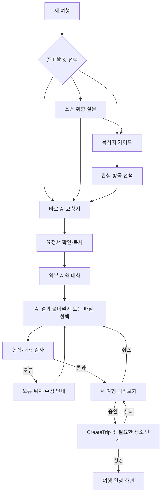

# travel-app · 여행계획 준비 MVP 요구사항 및 상세 설계서

- **문서 버전:** v0.1 · 2026-11-16
- **상태:** 설계 제안 / 사용자 검토·승인 전 / 구현·테스트 미실시
- **권장 저장 경로:** `docs/travel-prep-mvp-design.md`
- **상위 문서:** [`docs/ai-rework-requirements-design.md`](https://github.com/jeongjae/travel-app/blob/main/docs/ai-rework-requirements-design.md) **v0.5** (§2.1, §2.1-1, §3, §4.2~4.3, §4.6~4.8, §5, §7, §8.1, §9)
- **시험 입력:** [`docs/p0-guide-trial.md`](https://github.com/jeongjae/travel-app/blob/main/docs/p0-guide-trial.md), [`docs/e0-chatbot-trial.md`](https://github.com/jeongjae/travel-app/blob/main/docs/e0-chatbot-trial.md)
- **구현 근거:** `src/contracts/v2/planning.ts`, `src/contracts/v2/exchange.ts`, `src/contracts/v2/primitives.ts`, `package.json`

> **표기 규칙:** **[확정]** 기존 사용자 결정 또는 상위 문서에 확정된 요구, **[현행]** 소스에서 확인한 계약, **[제안]** 본 문서가 새로 구체화한 설계, **[미결정]** 승인·실측이 필요한 선택. 특히 가이드 출처(G-1), 저장 위치(G-2), 이동·장소 변환(M-1·M-2)은 확정으로 간주하지 않는다.

## 0. 의사결정 요약

**제품 가설:** 사용자가 여행 조건을 선택하고 목적지 가이드에서 관심 대상을 고른 뒤 AI와 대화하면, 백지 상태에서 AI에게 여행계획을 요청할 때보다 더 빠르게 원하는 여행의 큰 그림을 정할 수 있다.

**MVP의 완료 정의:** `조건·취향 선택 → 목적지 가이드 탐색·선택 → AI 요청서 복사 → 외부 챗봇에서 계획 수립 → 결과 붙여넣기/파일 → 검증·승인 → 새 여행 저장`의 전체 경로가 PC와 iPhone Chrome에서 동작한다. 모든 준비 단계는 선택 사항이며, 건너뛰어도 새 여행 만들기가 가능해야 한다.

| 항목 | 이번 MVP 제안 | 근거·제약 |
|---|---|---|
| 계획 생성 | 외부 ChatGPT·Claude 등에서 대화로 작성 | R-01, R-02 [확정] |
| 질문 | 핵심 질문 + 선택적 상세 질문, **미응답은 미지정** | R-08, R-11 [방향 제안] |
| 가이드 | **준비된 가이드가 있으면 즉시 카드 표시**; 없으면 AI 가이드 요청문을 복사해 결과를 붙여넣기 | G-1 [미결정]; v0.5의 B안 + 1개 시범 가이드 제공을 새로 제안 |
| 관심 표시 | `꼭 포함 / 관심 / 제외 / 미선택` | R-09 [방향 제안] |
| 요청서 | 입력값과 선택 항목을 결정적으로 조합; `travel-app-plan/1` 규칙 포함 | R-10, §4.6 [제안] |
| 결과 입력 | 텍스트 붙여넣기(기본) + `.md` 파일 | v0.5 §3 [제안] |
| DB 반영 | 사용자 승인 전에는 여행 DB 변경 금지; 새 여행 `CreateTrip` | R-07 [확정], `exchange.ts` [현행] |
| 임시 보존 | 같은 기기의 **준비 초안 1건**, `localStorage` 임시 저장 | G-2 [미결정], v0.5 §4.8의 1차 제안 |
| 직접 연동 | 외부 챗봇 API·MCP·서버 전송 없음 | v0.5 §2.3 [제안된 범위 제외] |

**설계 경계:** 이 MVP는 **새 여행 준비·최초 가져오기**를 완성한다. 기존 여행의 AI 수정·재가져오기(E2), 날짜별 AI 요청(E3), 프로필의 여행 간 공유(P2)는 별도 단계다. 이미 확정된 R-04(직접 입력), R-06(사후 수정) 의무를 취소하는 뜻이 아니다.

---

## 1. 사용자·문제·목표

### 1.1 대상 및 환경

- 개인 여행자 1명, 여행 전 계획 준비가 주요 상황이다.
- PC 웹 브라우저와 **iPhone Chrome**을 우선 검증한다(R-03).
- travel-app은 GitHub Pages에 배포되고, 여행 DB는 브라우저의 IndexedDB에 있다(상위 설계 §1).
- 여행계획을 생성하는 외부 AI 서비스는 사용자가 선택한다. 앱은 AI 응답을 자동으로 읽거나 전송하지 않는다.

### 1.2 해결할 문제

1. 여행지에 익숙하지 않으면 AI에게 무엇을 요청해야 할지 모른다.
2. 취향·예산·숙소·교통을 채팅에서 여러 번 설명해야 한다.
3. 추천받은 후보를 일정에 반영하기 전에 우선순위를 정리하기 어렵다.
4. AI 결과를 파일로 내려받아 다시 업로드하는 과정이 특히 모바일에서 번거롭다.
5. AI가 작성한 계획은 반드시 사용자 검토와 안전한 저장 과정을 거쳐야 한다.

### 1.3 성공 가설과 관찰 지표 [제안]

| 가설 | 관찰 방법 | P0/P1 시험 목표(제안) |
|---|---|---|
| 가이드가 여행 구도 이해를 돕는다 | 가이드 탐색 후 “여행에서 무엇을 할지 대략 정해졌다” 평가 | 사용자 **예/아니오 + 부족한 정보 기록** |
| 질문 템플릿이 부담을 줄인다 | 핵심 질문 작성 시간·건너뛰기 빈도 | 핵심 조건을 **약 3분 내** 선택 가능한지 실측 |
| 선택 결과가 AI 계획에 반영된다 | 꼭 포함·제외 항목과 AI 결과 대조 | 꼭 포함 누락·제외 위반을 **모두 식별**하고 사용자 평가 |
| 전달 과정이 간단하다 | 요청서 복사~결과 붙여넣기 행동 수·오류 | PC·iPhone 모두 **파일 저장 없이** 완료 가능 |
| 안전하다 | 취소·형식 오류·저장 실패 주입 | **미승인 DB 변경 0건, 조용한 데이터 손실 0건** |

숫자 목표는 출시 통계가 아니라 개인용 앱의 시범 사용 기준이다. P0의 기존 기준(가이드 2종 형식 통과, 15분 내 선택, 계획 비교)은 유지한다.

## 2. 범위와 단계

| 구분 | 포함 | 제외·후속 |
|---|---|---|
| 질문 | 여행지·기간·동행·인원·여행 목적·속도·예산·교통·숙소 유형/우선순위·추가 조건 | 개인 취향 자동 학습, 설문 추천 AI |
| 가이드 | 여행당 가이드 1건(복수 목적지 중 대표 목적지 1곳), 5개 유형 카드, 준비된 시범 가이드 또는 가이드 Markdown 붙여넣기 | 전 세계 가이드 사전 구축, 지도, 실시간 영업정보 |
| 선택 | 4상태 표시, 분류 필터, 선택 현황·소요 시간 참고 | 최적 경로 자동 계산, 여행 가능성 자동 확정 |
| AI 요청서 | 템플릿 조합·미리보기·복사·복사 실패 대안 | 챗봇 직접 실행·자동 제출·AI 계정 연동 |
| 계획 가져오기 | 텍스트·파일, 구문 분석, 검증, 변경 미리보기, 명시적 승인, 새 여행 저장 | 임의 PDF/Word 파싱, 자동 데이터 병합 |
| 저장 | 임시 준비 초안 1건(기기 내), 승인된 여행 DB | 기기 간 동기화, 준비 초안의 정식 백업·여행 간 재사용 |

**단계 게이트**

- **P0(코드 없는 시험):** 기존 `p0-guide-trial.md` 수행. 현재 문서상 사용자 시험 대기이며 통과했다고 가정하지 않는다.
- **E1(필수 기반):** 질문·Travel Brief + 텍스트/파일 가져오기 + 새 여행 생성. 가이드가 없어도 완료 가능.
- **P1(MVP 완성):** 가이드 가져오기/표시 + 관심 항목 선택 + Travel Brief 결합. 필요하면 **시범 목적지 1곳의 사전 준비 가이드**를 함께 제공하는 방안을 결정한다.
- **E2 이후:** 기존 여행의 부분 수정·기준 버전 검증, 선택 범위 내보내기 등 상위 설계대로 진행.

**주의:** 상위 v0.5의 단계 제안은 E1 → E2 → P1이다. 본 문서는 사용성 MVP를 조기에 검증하기 위해 **E1 → P1 → E2**를 권장하는 *새 제안*이다. 단계 순서는 사용자 승인 필요.

## 3. 정보 구조와 사용자 흐름

### 3.1 메뉴·진입점 [제안]

기존 주 탐색을 늘리지 않고 **여행 추가/새 여행**에서 진입한다.

- 기본 진입: `새 여행 → AI와 계획 만들기`.
- 화면 상단: `기본 조건 · 목적지 가이드 · AI 요청서 · 계획 가져오기`를 이동 가능한 구역으로 표시한다. 단계 완료를 강제하지 않는다.
- 언제나 보이는 보조 동작: `건너뛰고 AI 요청서 만들기`, `직접 입력`, `기존 .md 파일 가져오기`.
- 사용자가 돌아오면 저장된 **이 기기의 준비 초안**을 계속하거나 새로 시작한다.

### 3.2 대표 흐름



### 3.3 예외 흐름

| 상황 | 사용자 경험 | 데이터 처리 |
|---|---|---|
| 목적지·기간 미정 | 질문을 건너뛰고 AI에게 목적지/기간부터 상담 | 요청서에 `미정`을 명시하고, 최종 새 여행 저장 전에는 기간 확인 필요 |
| 가이드 없음 | “가이드 요청문 복사” 또는 “가이드 없이 진행” | 빈 가이드가 AI 요청서 생성을 막지 않음 |
| AI 가이드 양식 오류 | 줄 번호와 오류를 표시, 수정 요청문 복사 제공 | 기존 가이드/선택 상태 유지 |
| AI 결과가 일반 설명문 | Markdown 코드 블록 또는 표 구간 추출을 시도하되 불명확하면 거부 | 추측으로 일정 생성하지 않음 |
| 다른 기기에서 시작 | 임시 초안이 자동 이동하지 않음을 알림 | PC/iPhone DB 동기화로 오인시키지 않음 |
| 브라우저 종료 | 같은 기기에서 초안 복원 시도 | 저장소가 삭제됐으면 복원 불가 안내 |
| 사용자가 아무것도 고르지 않음 | 빈 선택 목록으로 요청서 생성 | 임의의 기본 선호를 넣지 않음 |

## 4. 상세 기능 요구사항

### 4.1 기능 요구사항 목록

| ID | 우선순위 | 기능 | 완료 조건 |
|---|---|---|---|
| FR-01 | 필수 | 준비 화면 진입·건너뛰기 | 어떤 질문도 답하지 않고 요청서 화면에 도달 |
| FR-02 | 필수 | 핵심 조건 입력 | 목적지·기간·동행·인원·예산을 독립적으로 수정 |
| FR-03 | 필수 | 취향 질문 | 복수 선택·단일 선택·자유 입력을 지원, 미응답 유지 |
| FR-04 | 필수 | 교통·숙소 선호 | 이동 수단과 숙소 유형/우선순위를 구분하여 입력 |
| FR-05 | 필수 | 질문 응답 요약 | 사용자가 선택한 값만 요약, 변경·초기화 가능 |
| FR-06 | 필수 | 가이드 요청문 생성 | 목적지·기간을 포함한 `travel-app-guide/1` 요청문 복사 |
| FR-07 | 필수 | 가이드 가져오기 | Markdown 표 1개를 결정적으로 읽고 오류 표시 |
| FR-08 | 필수 | 가이드 카드 표시 | 종류별 필터, 이름·지역·설명·소요·확인 필요 표시 |
| FR-09 | 필수 | 관심 표시 | 각 카드에서 꼭 포함·관심·제외·미선택 변경 |
| FR-10 | 필수 | 선택 현황 | 상태별 개수, 소요 시간 참고, 확인 필요 표시 |
| FR-11 | 필수 | Travel Brief 생성 | 선택한 질문·가이드 항목 + AI 지침 + 계획 양식 조합 |
| FR-12 | 필수 | 요청서 미리보기·복사 | 포함 정보 확인 후 복사, 실패 시 직접 선택·복사 가능 |
| FR-13 | 필수 | AI 결과 입력 | 붙여넣기 기본, `.md` 파일 선택 대안 |
| FR-14 | 필수 | 공통 파싱·검증 | 두 입력 경로의 동일 결과; 오류가 있는 내용은 무단 저장 금지 |
| FR-15 | 필수 | 적용 미리보기·승인 | 새 여행 정보·일정·숙소·장소 후보를 보여주고 확인 전 저장 금지 |
| FR-16 | 필수 | 새 여행 저장 | `CreateTrip` 등 현행 명령으로 저장, 이전 여행에 영향 없음 |
| FR-17 | 권장 | 임시 초안 보존 | 같은 기기에서 재진입 시 응답·가이드·선택 복원 |
| FR-18 | 필수 | 출처·확인 상태 | AI 생성 가이드를 미검증으로 표시, 변동 정보 확인 안내 |
| FR-19 | 조건부 | 사전 준비 가이드 선택 | 준비된 가이드가 있는 목적지는 별도 AI 왕복 없이 열람(시범 1곳 권장) |
| FR-20 | 필수 | 민감 정보·실패 처리 | 외부 복사 전 내용 확인, 오류·취소·저장 실패 시 안전한 상태 유지 |

우선순위 **필수**는 MVP 출시 게이트, **권장**은 사용자 편의성 보완, **조건부**는 사전 준비 가이드 1곳 제공(D-01·D-06)을 승인한 경우에만 필수다. 코드 없는 시험 단계 **P0**와 기능 우선순위를 구분한다.

### 4.2 질문 템플릿 명세 [제안]

| 필드 키 | 질문 / 표시명 | 입력 형식 | 선택지·검증 | AI 요청서 출력 |
|---|---|---|---|---|
| `destinations` | 어디로 가나요? | 자유 입력, 여러 목적지 허용 | 공백 항목 제거; 순서 보존 | 목적지 |
| `startDate`, `endDate` | 언제 가나요? | 날짜 또는 미정 | 둘 다 있으면 역순 금지 | 여행 기간 |
| `partyType` | 누구와 가나요? | 단일 | 혼자/부부·연인/가족/친구/기타 | 동행 유형 |
| `partySize` | 몇 명인가요? | 숫자 | 1 이상 정수; 미정 가능 | 인원 |
| `purposes` | 가장 기대하는 것은? | 복수 | 관광/휴식/미식/자연/문화·예술/쇼핑/체험 | 중요 활동 |
| `pace` | 어느 정도 속도가 좋나요? | 단일 | 여유/보통/알차게 | 여행 속도 |
| `visitExperience` | 방문 경험은? | 단일 | 처음/재방문 | 방문 경험 |
| `transport` | 선호하는 이동 방식은? | 단일 또는 복수 | 도보·대중교통/렌터카/택시/혼합 | 이동 선호 |
| `lodgingTypes` | 원하는 숙소 유형은? | 복수 | 호텔/료칸·전통 숙소/리조트/아파트형/게스트하우스/미정 | 숙소 유형 |
| `lodgingPriority` | 숙소 선택에서 중요한 것은? | 복수 | 교통 편의/관광 접근/조용함/가격 | 숙소 우선순위 |
| `budgetText` | 여행 예산은? | 짧은 자유 입력 | 금액·통화·1인/전체·항공 포함 여부를 안내, 강제하지 않음 | 사용자가 쓴 원문 그대로 |
| `mustConsider` | 꼭 고려할 조건은? | 자유 입력 | 비어도 됨; 민감 정보 주의 | 필수 고려사항 |
| `freeText` | 특별히 원하는 것은? | 자유 입력 | 비어도 됨 | 추가 요청 |

**질문 UX**

1. **빠른 설정:** 목적지·기간·여행 목적·속도·예산의 5문항을 우선 표시한다. 모두 건너뛸 수 있다.
2. **상세 설정:** 동행·인원·교통·숙소 유형·숙소 우선순위·방문 경험·추가 조건을 접힌 구역에 둔다.
3. **기본값 없음:** UI에 추천 예시를 보여 줄 수 있지만, 선택하지 않은 값을 사용자가 답한 것처럼 저장하거나 AI에 보내지 않는다(v0.5 §4.8과 일치).
4. **부분 완료:** 기간이 없거나 숙소가 미정이어도 Travel Brief를 만들 수 있다. 새 여행 DB 저장은 가져온 Markdown의 필수 정보 검증 뒤에만 허용한다.
5. **질문 의존성:** 동행 인원이 1명인 경우 가족 관련 추가 질문을 강제하지 않는다. 예산·숙소·교통도 조건부로만 세부 설명을 노출한다.
6. **프리셋:** 이번 MVP에서는 제공하지 않는다. v0.5의 E3 제안을 유지한다.

### 4.3 목적지 가이드 명세 [제안]

**목적:** 사용자가 일정을 짜기 전에 볼거리·먹거리·체험·코스·지역의 후보를 비교하고 관심도를 정한다.

**가이드 출처 정책(미결정 G-1)**

- **경로 A — 준비된 가이드:** 앱이 사전에 포함한 가이드가 있으면 바로 보여 준다. MVP에서는 **시범 목적지 1곳**만 제공하는 안을 권장한다. 이 콘텐츠는 개발자가 검토·작성해야 하며 자동으로 존재한다고 가정하지 않는다.
- **경로 B — 챗봇 가이드:** 준비된 가이드가 없으면 기존 `p0-guide-trial.md`의 요청문을 복사해 외부 챗봇에서 가이드를 만들고 앱에 붙여넣는다. 이 경로가 v0.5의 1차 제안이다.
- **경로 C — 가이드 없이 진행:** 가이드 작성·가져오기 없이 AI 여행계획 요청서를 만든다.
- **복수 목적지 제한:** 여행 목적지는 여러 개 입력할 수 있으나 P1의 가이드 선택은 **대표 목적지 1곳·가이드 1건**으로 제한한다. 가이드 화면에서 대표 목적지를 선택하고, 다른 목적지의 추천은 AI 요청서에서 조사하도록 안내한다. 다중 가이드 병합은 P2 후속 과제다.
- **목적지 미정:** 가이드 요청문 생성은 목적지 입력 후에만 활성화하고, 목적지 미정인 사용자는 질문 또는 AI 상담으로 이동하도록 한다.
- **MVP에서는** 외부 웹 검색 자동 실행, Worker 호출, 다른 여행의 가이드 DB 자동 공유를 하지 않는다.

**가이드 파일 계약:** 상위 설계 §4.8의 `travel-app-guide/1`을 변경하지 않는다.

```markdown
# 가이드: 예시 목적지
- 양식: travel-app-guide/1
- 기준일: 2026-11-16

## 항목
| 종류 | 이름 | 지역 | 한 줄 설명 | 예상 소요 | 확인 필요 |
|---|---|---|---|---|---|
| 볼거리 | 대표 명소 A | 중심 지역 | 지역을 대표하는 방문 후보 | 2시간 | 운영 시간 |
| 먹거리 | 지역 음식 B | 구도심 | 현지 식사 경험 | 식사 1회 | 식당 선택 |
| 체험 | 문화 체험 C | 중심 지역 | 참여형 활동 | 1~2시간 | 사전 예약 여부 |
| 코스 | 반나절 코스 D | 중심 지역 | 명소 A → 구도심 | 반나절 | 이동 동선 |
| 지역 | 구도심 E | 구도심 | 산책·숙박 거점 후보 | 반나절 | 현지 교통 |
```

**파싱·표시 규칙**

- 헤더의 `travel-app-guide/1`, `## 항목`, 6개 열 이름·순서를 검사한다. 알 수 없는 버전·잘못된 열 개수·허용되지 않은 `종류`는 저장 없이 오류를 표시한다.
- `종류` 허용값: `볼거리`, `먹거리`, `체험`, `코스`, `지역`.
- `기준일`은 **AI가 작성한 기준일**이지 사실 검증 완료일이 아니다. 화면에 `AI 생성 · 내용 미검증`을 표시한다.
- 영업시간·가격·실시간 예약 여부는 가이드에 넣지 않는다. 확인할 사항만 `확인 필요`에 둔다.
- 설명·이름은 **텍스트로만 렌더링**한다. HTML·스크립트·이벤트 핸들러는 실행하지 않는다.
- 중복된 `종류+이름+지역`은 사용자에게 경고하고 중복 카드를 임의 병합하지 않는다.
- 가이드가 바뀌면 이전 선택의 자동 승계를 금지한다. `새 가이드로 교체하면 선택이 초기화됩니다`를 먼저 확인한다.
- 목록은 종류별 필터와 검색을 제공하되, **초기 정렬은 원본 행 순서**를 유지한다.

**관심 항목 상태**

| 상태 | UI 표현 | Travel Brief에 반영 |
|---|---|---|
| 미선택 | 기본 상태 | 포함하지 않음 |
| 꼭 포함 | 가장 높은 우선순위 | `반드시 포함을 검토; 불가능하면 이유와 대안을 설명` |
| 관심 | 여건이 되면 포함 | `동선·시간에 맞으면 포함` |
| 제외 | 추천하지 않음 | `원칙적으로 포함하지 않음` |

`꼭 포함`도 **예약·방문 확정**을 의미하지 않는다. AI가 운영시간·동선·휴관을 확인하지 못하면 이를 명시해야 한다. 소요 시간은 원문을 표시하고, `2~3시간`, `반나절` 같은 값을 임의의 정확한 시간으로 바꿔 합산하지 않는다. MVP의 선택 현황은 **개수 중심**이며 소요 시간은 참고 텍스트로만 제공한다.

### 4.4 AI 여행계획 요청서(Travel Brief) 생성 [제안]

**생성 시점:** 사용자가 `AI 요청서 만들기`를 누르면 최신 화면 상태에서 즉시 다시 생성한다. 사용자가 수정을 하면 기존 복사본은 자동 갱신되지 않으므로 다시 복사하도록 안내한다.

**요청서 구성 순서**

1. 사용자가 입력한 여행 조건(미응답 제외).
2. 취향·제약(미응답 제외, 자유 입력은 원문 보존).
3. 선택한 가이드 항목: `꼭 포함`, `관심`, `제외` 세 묶음(미선택 제외).
4. 확인이 필요한 사항: 가이드 `확인 필요` 중 선택 항목에 해당하는 내용, 미정인 여행 조건.
5. AI 작업 지시: 여행 구도 제안 → 숙소 거점 → 날짜별 일정 → 동선·이동 검토 → 미확인 사항 질문 → 사용자 요청 시 Markdown 출력.
6. **정식 계획 양식 안내문**: `plan-format-v1-prompt.md`의 현행 규칙을 포함한다. 양식 이름·열 이름을 새로 정의하지 않는다.

**요청서 예시(일부)**

```text
[여행 조건]
목적지: 교토·오사카
기간: 2027-04-02 ~ 2027-04-05
동행: 성인 2명
예산: 2인 합계 약 120만 원, 항공 제외 (사용자 입력)
이동: 대중교통 중심
숙소 유형: 호텔

[꼭 포함]
- 볼거리 / 기요미즈데라 / 히가시야마
- 먹거리 / 교토 전통 음식 / 교토

[관심]
- 체험 / 다도 체험 / 교토

[제외]
- 쇼핑 중심 일정

[요청]
1. 선택한 조건을 기준으로 여행의 큰 구도를 먼저 제안해 주세요.
2. 숙소 지역·날짜별 일정·이동 동선을 함께 검토해 주세요.
3. 확인되지 않은 운영시간·가격·예약 가능 여부는 사실처럼 확정하지 마세요.
4. 불확실하거나 충돌하는 조건은 질문해 주세요.
5. 제가 '정리해 줘'라고 하면 아래 travel-app-plan/1 양식에 맞는
   markdown 코드 블록 하나로 결과를 출력해 주세요.

[이하: 앱의 공식 계획 양식 안내문 전문]
```

**개인정보 보호**

- 복사 전에 **외부 챗봇에 전달되는 전체 텍스트를 펼쳐 확인**할 수 있게 한다.
- 예약번호·연락처·현장 기록·개인 식별정보는 기본적으로 요청서에 넣지 않는다.
- 사용자가 자유 입력란에 민감한 정보를 넣었을 수 있음을 알리고 복사 전 편집/제외할 수 있게 한다.
- `클립보드 복사` 실패 시 텍스트 선택·수동 복사, `.txt` 저장 대안을 제공한다.
- 복사는 **사용자 동작**이며 앱이 AI 서비스로 자동 전송하지 않는다.

### 4.5 AI 결과 가져오기·저장 [상위 설계 재사용]

**입력:** ① 텍스트 붙여넣기(기본) ② `.md` 파일 선택. 둘 다 같은 `travel-app-plan/1` 파서로 전달한다.

**처리 파이프라인**

```text
텍스트/파일 → 코드 블록·외부 설명 정규화 → 버전/표 파싱 → 필드 검증
→ 여행 대상·장소 후보 확인 → 변경 미리보기 → 명시적 승인 → 저장 명령 → 결과 화면
```

- E0 2회차에서 ChatGPT 3/3·Claude 3/3의 **형식 시험**이 통과했다. **실제 변환기 시험은 아직 수행되지 않았다.** E1에서 같은 결과를 자동 테스트에 사용한다.
- 새 여행은 `CreateTrip`을 사용한다. 다른 여행을 자동 수정·삭제하지 않는다.
- 날짜·시간대·필수 값·중복·참조를 검사하고, 오류가 있으면 저장하지 않는다. 알 수 없는 항목을 조용히 버리지 않는다.
- **기존 여행**에서 새 장소가 필요한 경우 상위 설계 §4.3의 **장소 승인과 계획 승인 2단계**를 따른다. 두 단계는 하나의 원자 트랜잭션이 아니며, 장소 승인 뒤 계획 실패 시 **승인된 장소는 남을 수 있음**을 사용자에게 명시한다.
- **새 여행의 장소 저장 순서는 별도 구현 결정이 필요하다.** `CreateTrip`은 `initialPlan`을 받지만 `CreateContentBatch`는 별도 명령이다. 새 여행이 아직 존재하지 않는 상태에서 장소를 먼저 만들 수 있는지, 새 장소 ID를 초기 계획에서 참조할 수 있는지는 **현재 읽은 계약만으로 보장할 수 없다**. E1에서 실제 명령 처리와 참조 검사를 확인하고, 승인된 여행 생성 → 장소 생성 → 연결 반영의 단계적 처리 또는 초기 계획에서 장소명을 메모로 보존하는 방식을 결정한다. 사용자에게 중간 상태와 재시도 방법을 알려야 한다. **임의의 단일 트랜잭션을 가정하지 않는다.**
- 가져오기 취소 시 승인하지 않은 데이터는 저장되지 않는다. 재시도 중에도 다른 여행의 계획·현장 기록은 바뀌지 않는다.
- `travel-app-guide/1`은 **가이드 선택용 임시 자료**다. 가이드 항목 선택만으로 `place`·`planItem`을 생성하지 않는다. **AI가 생성한 최종 계획을 가져올 때만** 일정 데이터 후보가 된다.
- 기존 여행 수정은 E2로 미룬다. 그때는 `ChangePlan`, `기준계획`·`기준revision`, `(비움)`·`## 삭제` 규칙을 사용한다.

**차단 중인 선행 결정**

- **M-1:** 상위 §8.1의 이동 표(`## 이동`)를 v1에서 제거할지, 지명으로부터 `planLeg` 연결을 해석할지 미결정. **권장: 상위 제안 ①(이동은 일정 표의 `이동` 항목으로만 수용)**. 사용자 결정 전에는 변환 규칙을 임의로 확정하지 않는다.
- **M-2:** 일정의 장소 칸이 장소 표에 없는 이름을 어떻게 보존할지 미결정. **권장: 상위 제안 ①(장소 생성 후보 제시, 미선택 시 `[장소: 이름]` 메모 보존)**.
- **M-3(신규):** 새 여행의 `CreateTrip`과 신규 장소 생성·연결을 어떤 순서로 승인·실행할지 미정이다. `CreateTrip` 성공 후 장소 단계 실패 등 중간 상태를 시험해야 한다. **E1 착수 전 명령 구현 확인과 사용자 승인 필요**.

## 5. 화면 설계 [제안]

### S1. 새 여행 / 질문

```text
┌──────────────────────────────────┐
│ 새 여행 준비                     │
│ [기본 조건] [가이드] [AI 요청서]  │
│                                  │
│ 어디로 가나요?  [목적지 입력]     │
│ 언제 가나요?    [기간 / 미정]     │
│ 여행 목적은?    [관광][미식]...   │
│ 여행 속도는?    [여유][보통]...   │
│ 예산은?        [직접 입력]        │
│                                  │
│ ▸ 교통·숙소·동행 등 상세 설정     │
│                                  │
│ [가이드 살펴보기]                 │
│ [건너뛰고 AI 요청서 만들기]       │
└──────────────────────────────────┘
```

### S2. 목적지 가이드 / 선택

```text
┌──────────────────────────────────┐
│ 교토 가이드 · AI 생성/미검증      │
│ [전체][볼거리][먹거리][체험]...   │
│                                  │
│ 기요미즈데라 · 히가시야마         │
│ 역사·풍경을 즐기는 방문 후보      │
│ 예상 소요: 2시간 · 운영시간 확인  │
│ ( ) 꼭 포함 ( ) 관심 ( ) 제외    │
│                                  │
│ 선택: 꼭 포함 2 · 관심 3 · 제외 1│
│ [선택 반영해 AI 요청서 만들기]    │
└──────────────────────────────────┘
```

**가이드 없음 화면:** `아직 준비된 가이드가 없습니다` + `[AI에게 가이드 요청문 복사]` + `[가이드 결과 붙여넣기]` + `[가이드 없이 계속]`.

### S3. AI 요청서

- 요약: 조건 n개·꼭 포함 n개·관심 n개·제외 n개.
- 전체 요청서 미리보기(접기/펼치기), 민감 정보 안내.
- 기본 버튼: `[AI 요청서 복사]`.
- 보조 버튼: `[질문 수정]`, `[가이드 선택 수정]`, `[AI 결과 가져오기]`.
- 복사 후 안내: `사용할 챗봇을 열어 붙여넣고 대화하세요. 계획이 정리되면 '정리해 줘'라고 요청하세요.`

### S4. AI 결과 가져오기

- 입력 탭: `[텍스트 붙여넣기]` / `[.md 파일 선택]`.
- `[검사하기]` → 오류 위치·수정 안내 또는 미리보기.
- 미리보기: 여행 이름·기간·시간대·날짜별 일정·숙소·장소 후보·경고·승인 단계. 가이드에서 고른 `꼭 포함/제외` 목록을 옆에 표시해 **사용자가 수동으로 반영 여부를 확인**한다. AI 결과와 자동 의미 비교하거나 일정을 자동 고치지는 않는다.
- 승인 버튼: `[이 내용으로 새 여행 저장]`. 승인 전 DB 쓰기 금지.
- 성공 시 여행 화면으로 이동, 실패 시 원본 입력과 오류를 유지.

### 반응형·접근성

- iPhone 폭에서는 한 열, 큰 터치 영역, 하단 고정 주요 버튼을 우선한다. 카드의 관심 상태는 색만으로 구분하지 않고 **텍스트·선택 상태**를 함께 표시한다.
- 키보드만으로 질문·선택·복사·가져오기를 수행할 수 있어야 한다.
- 오류는 해당 필드와 요약 영역에 함께 표시하고 화면 읽기 도구가 인식할 수 있게 한다.
- 긴 요청서는 전체를 표시하되 기본 화면은 요약과 복사 버튼에 집중한다.

## 6. 임시 데이터·컴포넌트 설계

### 6.1 임시 준비 초안 [제안; G-2 승인 전]

**MVP 저장소:** `localStorage`의 버전 있는 단일 키. 여행 DB(IndexedDB)나 백업 스키마는 변경하지 않는다. `localStorage`는 기기·브라우저별이며 백업·복원·동기화를 보장하지 않는다.

```ts
// 개념 설계. 현재 저장소에 이미 구현된 타입이 아님.
type PrepDraftV1 = {
  schemaVersion: 1;
  draftId: string;
  updatedAt: string;
  answers: {
    destinations?: string[];
    startDate?: string;
    endDate?: string;
    partyType?: string;
    partySize?: number;
    purposes?: string[];
    pace?: string;
    visitExperience?: string;
    transport?: string[];
    lodgingTypes?: string[];
    lodgingPriority?: string[];
    budgetText?: string;
    mustConsider?: string;
    freeText?: string;
  };
  guide?: {
    format: 'travel-app-guide/1';
    destination: string;
    referenceDate: string;
    sourceType: 'bundled' | 'chatbot-paste';
    digest: string;
    items: Array<{
      key: string; // guide digest + 행 번호로 결정적으로 생성
      kind: '볼거리' | '먹거리' | '체험' | '코스' | '지역';
      name: string;
      area: string;
      description: string;
      durationText: string;
      needsCheck: string;
    }>;
  };
  selections: Record<string, 'must' | 'interested' | 'exclude'>;
};
```

**정합성·수명**

- 초안은 앱 실행 중 입력 변경 시 저장한다. 브라우저 저장 공간 오류는 사용자에게 알려 주고 메모리 상태로 계속 진행할 수 있다.
- 새 초안 시작 시 기존 초안을 덮어쓸지 묻는다. 별도의 자동 삭제는 하지 않는다.
- 가이드 교체 시 digest가 달라지면 선택 상태 초기화 확인을 받는다.
- 초안에서 여행 DB로 자동 복사되는 것은 **없다**. 최종 계획 Markdown을 승인해 저장한 데이터만 여행 DB에 들어간다.
- 초안은 백업 대상이 아니므로 `다른 기기에서 이어하기`를 지원하는 것처럼 표현하지 않는다.
- 개인적 제약·민감 정보가 초안에 남을 수 있다. `준비 초안 지우기`를 제공하고 외부 AI 복사 전에 내용을 확인한다.

### 6.2 컴포넌트·모듈 경계 [제안]

| 모듈 | 책임 | 재사용/신규 |
|---|---|---|
| `TravelPrepPage` | 화면 흐름·진입·건너뛰기 | 신규 React 화면 |
| `PreferenceQuestions` | 질문 정의·입력·검증 | 신규, Zod 활용 가능 |
| `GuideMarkdownParser` | `travel-app-guide/1` 표 검증·중간 구조 생성 | 신규, 기존 `remark-*` 활용 가능 |
| `GuideCards` | 종류 필터·관심 표시 | 신규 |
| `PrepDraftStore` | 임시 저장·복원·초기화 | 신규, localStorage 어댑터 |
| `TravelBriefBuilder` | 입력·선택을 공식 안내문과 조합 | 신규, 순수 함수 |
| `PlanMarkdownImporter` | `travel-app-plan/1` 파싱·검증 | 상위 설계 E1의 신규 모듈 |
| `ImportReview` | 미리보기·사용자 승인 | 상위 설계 E1의 신규 UI |
| `CommandGateway` | `CreateTrip`·장소 승인 등 저장 명령 | 기존 계약 사용, 어댑터 보완 |

**구현 경계:** `GuideMarkdownParser`와 `PlanMarkdownImporter`는 **다른 버전·스키마**를 갖는다. 텍스트 입력 UI와 Markdown 표 유틸리티는 공유할 수 있으나, 가이드 표를 계획 표로 직접 변환하거나 가이드 선택만으로 DB를 수정하지 않는다.

### 6.3 데이터 흐름

```text
질문 응답 ────────┐
                 ├──> PrepDraft(임시) ──> TravelBriefBuilder ──> 클립보드
가이드 Markdown ─> 파서 ─> 카드 선택 ┘                              │
                                                                  ▼
                                                              외부 챗봇
                                                                  │
                                                   Markdown 복사/파일 선택
                                                                  ▼
                                               PlanMarkdownImporter
                                                                  ▼
                                               검증·미리보기·승인
                                                                  ▼
                                            IndexedDB(여행·계획 버전)
```

**보안 경계:** 가이드·계획의 Markdown과 AI가 출력한 텍스트는 신뢰할 수 없는 입력이다. HTML 렌더링, 링크 처리, 용량 제한, 저장 명령 검증을 분리한다. 텍스트/파일은 사용자 브라우저에서 파싱하며 자동으로 Worker로 보내지 않는다.

## 7. 수용 기준과 시험 시나리오

| ID | 검증 시나리오 | 통과 조건 |
|---|---|---|
| MVP-AC-01 | 아무 질문도 답하지 않고 시작 | 요청서 생성·복사 가능; 미답변 값이 사실처럼 들어가지 않음 |
| MVP-AC-02 | 목적지·기간만 입력 | 다른 질문 없이 AI 요청서 생성 가능 |
| MVP-AC-03 | 복수 목적·숙소 유형·교통 선택 | 선택값이 요청서에 빠짐없이 들어가며 중복·임의 추가 없음 |
| MVP-AC-04 | 예산 원문에 통화·포함 범위 입력 | 원문이 보존되고 앱이 금액을 임의 환산하지 않음 |
| MVP-AC-05 | 준비된 가이드가 있는 목적지 | 가이드 요청·붙여넣기 없이 카드 열람 가능(시범 콘텐츠 채택 시) |
| MVP-AC-06 | 가이드가 없는 목적지 | 가이드 요청문 복사·결과 붙여넣기 또는 건너뛰기 가능 |
| MVP-AC-07 | 가이드 Markdown 오류·모르는 종류 | 오류 위치·원인을 보여 주고 기존 선택·여행 DB는 불변 |
| MVP-AC-08 | 5종 카드에 꼭 포함·관심·제외 선택 | 상태가 카드와 요약에 일치, 미선택은 요청서에서 제외 |
| MVP-AC-09 | 가이드 교체 | 선택 초기화 경고; 취소 시 기존 가이드·선택 유지 |
| MVP-AC-10 | 선택 항목의 `확인 필요` | 요청서에 검증 필요로 표기, 사실·예약 확정으로 표현하지 않음 |
| MVP-AC-11 | 동일 준비 초안으로 두 번 요청서 생성 | 동일 입력·양식 버전에서 같은 요청서 본문 생성 |
| MVP-AC-12 | 민감한 자유 입력 후 복사 | 외부 전달 텍스트를 확인·수정/제외 가능; 자동 외부 전송 없음 |
| MVP-AC-13 | 클립보드 권한 차단 | 요청서가 화면에 남아 직접 복사 가능 |
| MVP-AC-14 | 같은 계획을 텍스트·`.md`로 입력 | 파싱·검증·미리보기 결과 동일 |
| MVP-AC-15 | PC Chrome과 iPhone Chrome에서 동일 파일 사용 | 같은 입력에 동일한 검증·계획 데이터; 화면 조작 가능 |
| MVP-AC-16 | 잘못된 시간·날짜·구역·열 개수 | 오류 표시, 승인·저장 불가, 기존 여행 불변 |
| MVP-AC-17 | 미리보기 취소 | 새 여행 생성·기존 여행 변경 0건 |
| MVP-AC-18 | 저장 실패 주입 | 승인되지 않은 변경 0건, 실패·재시도 안내; 장소 2단계는 상위 계약 준수 |
| MVP-AC-19 | 저장 성공 | 새 여행 일정 표시, 다른 여행·현장 기록 불변, 백업에 승인된 여행 데이터 포함 |
| MVP-AC-20 | 준비 도중 새로고침 | 같은 기기에서 임시 초안 복원; 저장소 삭제 시 복원 불가 안내 |
| MVP-AC-21 | 오프라인 | 준비된 가이드·질문·요청서 생성·가져오기 파싱 가능; **외부 챗봇 대화는 온라인 필요** |
| MVP-AC-22 | AI 계획에서 가이드 선택과 다르게 출력 | 미리보기에 선택 항목 확인 목록을 제공하고 사용자가 대조할 수 있다. 자동 의미 판정·수정은 하지 않는다 |
| MVP-AC-23 | 신규 장소가 포함된 새 여행 저장 | `CreateTrip`과 장소 저장의 실행 순서·승인 범위·중간 실패 후 복구가 명시된 계약대로 동작하고, 조용한 장소명 손실 0건 |

**상위 수용 기준 병행:** `AC-01~24` 중 해당 단계의 기준을 그대로 적용한다. 특히 `AC-01`(조용한 손실 0), `AC-02`(PC/iPhone), `AC-07`(오프라인), `AC-14`(취소·실패), `AC-19`(붙여넣기/파일 동일), `AC-22`(질문 건너뛰기), `AC-23`(가이드 선택 반영), `AC-24`(가이드만으로 여행 DB 변경 없음)를 만족해야 한다. 번호는 상위 문서의 번호를 따른다.

### 7.1 시험 세트

1. **가상 교토 3박 4일:** 기본 조건·취향·가이드 선택 → Travel Brief → ChatGPT/Claude 계획 → 붙여넣기 → 새 여행.
2. **가이드 없는 목적지:** 가이드 요청문 복사 → AI 가이드 붙여넣기 → 관심 선택 → 요청서.
3. **질문 전부 건너뛰기:** AI 상담용 요청서 생성 → 목적지·기간을 대화로 정함 → 결과 가져오기.
4. **오류/실패:** 잘못된 가이드 열, Markdown 파이프(`\|`), 중복 항목, 잘못된 시간, 저장 실패, 새로고침, 클립보드 차단.
5. **실기기:** iPhone Chrome에서 붙여넣기·스크롤·관심 선택·오류 수정·저장, 네트워크 차단 시 로컬 동작.

**P0의 실제 사용자 평가:** 15분 내 가이드 선택 가능 여부, 큰 그림 이해 여부, 가이드 유무에 따른 AI 계획의 적합도, 반드시 포함/제외 반영률을 기록한다. 표본이 작으므로 보편적 품질 검증으로 해석하지 않는다.

## 8. 개발 작업 분해와 완료 게이트

| 순서 | 작업 | 산출물 | 선행 조건 |
|---|---|---|---|
| 0 | P0 가이드 사용성·형식 시험 | 결과 기록, G-1 1차 판단 | 기존 `p0-guide-trial.md` |
| 1 | M-1·M-2 및 새 여행 장소 저장 순서(M-3) 확정 | 상위 설계 §8.1 결정·명령 처리 확인 기록 | E1 파서·저장 구현 전 |
| 2 | 질문 정의·입력 UI | 화면·Zod 검증·질문 테스트 | R-08 범위 확인 |
| 3 | Travel Brief 생성·복사 | 순수 함수·공식 계획 안내문 결합 | 질문 모델 |
| 4 | 계획 Markdown 파서·붙여넣기·파일 | 파서·오류·E0 회귀 테스트 | 상위 §4.2 계약 |
| 5 | 새 여행 미리보기·저장 | `CreateTrip` 경로·실패 테스트 | 단계 4 |
| 6 | 가이드 Markdown 파서·카드·관심 선택 | 가이드 화면·선택 상태 | P0 결과·G-1 결정 |
| 7 | 준비 초안 임시 저장·복원 | `PrepDraftV1`·초기화·실패 안내 | G-2 임시 정책 결정 |
| 8 | 가이드 선택과 Travel Brief 결합 | 최종 E1+P1 전체 흐름 | 단계 3·6 |
| 9 | PC/iPhone·오프라인·백업 검증 | 수용 기준 체크리스트·잔여 위험 | 전체 기능 |

**출시 판정:** ① P0 결과 기록, ② 핵심 MVP-AC 통과, ③ 조용한 데이터 손실 0건, ④ 실기기 PC/iPhone 확인, ⑤ 미확정 범위와 알려진 한계 공개, ⑥ 사용자 승인. 문서 작성만으로 개발·출시가 승인된 것은 아니다.

## 9. 위험과 대응

| 위험 | 영향 | 대응 |
|---|---|---|
| 가이드가 부정확하거나 오래됨 | 잘못된 여행 판단 | AI 생성·미검증 표기, 출처/기준일 표시, 변동 정보 확인 필요 |
| 가이드 준비 자체가 추가 작업 | 초기 편의성 악화 | 준비된 가이드 우선, 없는 경우 AI 요청/건너뛰기; P0에서 시간 측정 |
| 많은 질문으로 피로 | 중도 이탈 | 빠른 설정 5문항, 상세 접기, 모두 건너뛰기 |
| 관심 선택과 실제 계획 불일치 | 기대 불일치 | 요청서에 상태 구분, 결과 미리보기에서 사용자 확인; 자동 강제 변경 금지 |
| 가이드 교체 후 잘못된 연결 | 다른 항목에 관심 상태 적용 | 가이드 digest 기준, 교체 시 명시적 초기화 |
| 로컬 초안 소실 | 입력 재작업 | 임시 저장 한계 표시, 필요 시 요청서 복사/텍스트 저장 |
| 개인 정보가 외부 AI로 전달 | 정보 노출 | 전송 내용 미리보기, 민감 정보 기본 제외, 자동 전송 없음 |
| AI 결과 형식 실패 | 가져오기 중단 | 코드 블록 안내, 오류 위치·재요청 문구, E0 결과 회귀 시험 |
| 기존 계획·현장 기록 훼손 | 데이터 손실 | 승인·검증·저장 명령, 기존 여행 분리, 백업 시험 |

## 10. 사용자에게 확인받을 결정

| ID | 질문 | 권장안 | 승인 전 상태 |
|---|---|---|---|
| **D-01 / G-1** | 가이드를 어디서 준비할까? | **시범 목적지 1곳은 사전 준비**, 다른 목적지는 **챗봇 가이드 붙여넣기**; 가이드 없이 진행도 허용 | **미결정**. 상위 v0.5는 챗봇 붙여넣기를 1차 권장 |
| **D-02 / G-2** | 질문·선택 결과를 어디에 저장할까? | MVP는 **기기 내 임시 초안 1건**, 여행 DB·백업 미포함. 장기 재사용은 P2 | **미결정** |
| **D-03** | 가이드 선택 기능을 E2보다 먼저 만들까? | **E1 → P1 → E2**로 MVP를 우선 검증 | **미결정**. 상위 v0.5는 E1 → E2 → P1 |
| **D-04 / M-1** | 이동 표를 어떻게 처리할까? | 상위 §8.1의 ①: v1 이동은 일정의 이동 항목으로 표현 | **미결정** |
| **D-05 / M-2** | 일정의 미등록 장소 이름을 어떻게 처리할까? | 상위 §8.1의 ①: 새 장소 후보 제시, 미선택 시 메모로 보존 | **미결정** |
| **D-06** | 사전 준비할 첫 목적지는? | 실제 다음 여행 후보 **1곳**을 선정. 교토는 시험 예시일 뿐 확정 아님 | **미결정** |
| **D-07** | 숙소 유형 질문을 MVP에 추가할까? | **추가**. 기존 §4.8의 숙소 우선순위와 별도 필드 | **새 제안** |
| **D-08 / M-3** | 새 여행과 새 장소의 저장·승인 순서는? | 실제 `CreateTrip`·`CreateContentBatch` 처리 확인 후, 장소명을 잃지 않는 단계적 저장·실패 복구 계약 결정 | **신규 선행 결정** |

### 결정 후 문서 반영 순서

1. D-01~D-08의 승인·수정 결과를 상위 `ai-rework-requirements-design.md`의 §4.8·§5·§8.1에 반영한다.
2. P0 시험 결과를 기록하고 가이드 생성 경로의 타당성을 확인한다.
3. E1 작업 지시서에 질문·Travel Brief·가져오기·실기기 검증을 반영한다.
4. P1 작업 지시서에 가이드 파서·카드·관심 상태·임시 저장·가이드 출처 표시를 반영한다.

---

## 부록 A. 요구사항 추적표

| 상위 요건 | MVP 대응 | 검증 |
|---|---|---|
| R-01·R-02 | 외부 챗봇에서 Markdown 계획 작성, 앱으로 가져오기 | MVP-AC-14~19 |
| R-03 | PC/iPhone Chrome | MVP-AC-15 |
| R-04 | 직접 입력 경로 유지(기존/후속 E3) | 상위 E3·AC-14 |
| R-05 | 질문·가이드 건너뛰기, 순서 강제 금지 | MVP-AC-01~02 |
| R-06 | 기존 여행 수정은 E2 경로 유지 | 상위 AC-08~11, AC-20~21 |
| R-07 | 명시적 승인, 버전·오프라인·백업 보존 | MVP-AC-16~21 |
| R-08 | 선택형 질문 템플릿 | MVP-AC-01~04 |
| R-09 | 가이드·관심 상태 | MVP-AC-05~10 |
| R-10 | Travel Brief 자동 생성 | MVP-AC-11~13 |
| R-11 | 선택적·비순차 흐름 | MVP-AC-01~02, 06 |

## 부록 B. 설계 검토 시 확인할 구현 사실

- **확인:** `package.json`에 React 19, TypeScript, Zod, `remark-parse`·`remark-gfm`, Dexie가 있다. 신규 화면·Markdown 파서 구현에 활용할 수 있다.
- **확인:** `src/contracts/v2/exchange.ts`에 `CreateTrip`, `ChangePlan`, `CreateContentBatch` 명령이 있으며, `ChangePlan`은 기존 계획의 기준 revision을 검사한다.
- **확인:** `src/contracts/v2/planning.ts`의 `planLeg`는 `fromActivityId`·`toActivityId`를 요구한다. 따라서 지명만 적힌 AI 이동 표를 무검증으로 연결할 수 없다(M-1).
- **확인:** `src/contracts/v2/primitives.ts`의 ID는 최대 160자의 허용 문자 패턴이며 UUID만 허용하는 것은 아니다. 문서에 짧은 ID 충돌을 전제하지 않는다.
- **미확인:** 실제 브라우저 화면에서 새 여행 진입점의 정확한 위치, 실기기 붙여넣기 동작, 기존 가이드 콘텐츠의 목적지별 재사용 가능성, P0 사용자 시험 결과. 구현 전에 확인한다.

**본 문서는 독립적인 MVP 설계 초안이며, 저장소의 실제 파일을 수정하거나 기능을 구현한 결과물이 아니다.**
